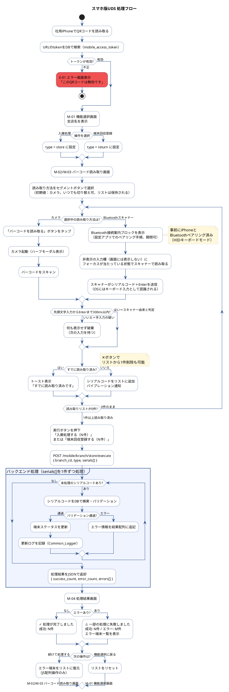

# UX設計：スマホ版UDS — 入庫処理・回収済み処理

**作成日:** 2026-06-01  
**前提:**
- デバイス：社用iPhone（iOS Safari）
- アクセス：VPN（AnyConnect）経由、QRコード読み取りでURLへアクセス
- バーコード読み取り：カメラAPI、またはBluetoothバーコードスキャナー（HIDキーボードエミュレーションモード）のどちらか（併用可）。実機検証でカメラでは小型バーコードを読み取れない可能性が判明したため、2026-09にBluetoothスキャナー対応を追加
- 一括処理：複数読み取り後、ボタン押下で一括実行
- エラー時：エラー端末のみ報告し、成功分は処理を確定する

---

## 1. 画面一覧

| 画面ID | 画面名 | URL |
|--------|--------|-----|
| M-01 | 機能選択画面 | `/mobile/branch/store?token={支店ごとの不透明トークン}`（2026-09〜。`branch_cd`は直接URLに含めない。詳細は開発概要書「QRコードURLのアクセストークン化」参照） |
| M-02 | バーコード読み取り画面（入庫処理） | 同URL内でJSにより画面切り替え（SPA方式） |
| M-03 | バーコード読み取り画面（端末回収登録） | 同URL内でJSにより画面切り替え（SPA方式） |
| M-04 | 処理結果画面 | 同URL内でJSにより画面切り替え。`/mobile/branch/store/execute`のJSONレスポンスを元に描画 |
| E-01 | エラー画面（トークン不正） | 同URL。サーバー側で`token`を検証し、初回表示時に出し分け |

---

## 2. 画面遷移図

```
QRコード読み取り
      │
      ▼
  [M-01] 機能選択画面
  ○○支店であることを確認
      │
      ├─── 「入庫処理」押下 ────────► [M-02] バーコード読み取り（入庫処理）
      │                                          │
      └─── 「端末回収登録」押下 ───────► [M-03] バーコード読み取り（回収済み）
                                                 │
                                    （共通）      │ 「実行」ボタン押下
                                                 ▼
                                          [M-04] 処理結果画面
                                                 │
                                    ┌────────────┴───────────┐
                                    │                         │
                              「続けて処理する」         「機能選択に戻る」
                                    │                         │
                              [M-02/03] に戻る          [M-01] に戻る
                              （エラー端末をリストに復元）
```

---

## 2-1. 処理フロー図（PlantUML）



---

## 3. 各画面のワイヤーフレーム

---

### M-01 機能選択画面

```
┌─────────────────────────────────┐
│                                  │
│         ┌──────────┐            │
│         │  UDS ロゴ │            │
│         └──────────┘            │
│                                  │
│  ┌──────────────────────────┐   │
│  │        ○○支店            │   │  ← branch_cdからDB取得した支店名
│  └──────────────────────────┘   │
│                                  │
│  ┌──────────────────────────┐   │
│  │                           │   │
│  │       入庫処理        │   │  ← c-btn is-ok （緑）
│  │                           │   │
│  └──────────────────────────┘   │
│                                  │
│  ┌──────────────────────────┐   │
│  │                           │   │
│  │      端末回収登録       │   │  ← c-btn is-blue （青）
│  │                           │   │
│  └──────────────────────────┘   │
│                                  │
└─────────────────────────────────┘
```

**仕様:**
- `token` に対応する支店が存在しない・無効な場合はエラー画面（E-01）へ遷移
- 支店名は画面上部に常に表示し、誤操作を防ぐ
- ボタンは大きく（タップしやすい高さ 56px 以上）

---

### M-02/M-03 バーコード読み取り画面

読み取り方法（カメラ／Bluetoothスキャナー）は常時両方表示すると分かりにくいため、**画面上部のセグメントボタンで明示的に切り替える**方式に変更した（2026-09見直し）。

**パターンA：「カメラ」選択時（初期状態）**

```
┌─────────────────────────────────┐
│ ← 戻る                           │
│ ○○支店 ／ 入庫処理           │  ← 支店名 + 機能名をヘッダーに表示
├─────────────────────────────────┤
│  読み取り方法                     │
│  ┌────────────┬────────────┐   │
│  │ 📷 カメラ   │ 📡 スキャナー│   │  ← セグメントボタン（トグル）
│  │  （選択中） │            │   │     選択中の方だけ強調表示
│  └────────────┴────────────┘   │
│                                  │
│  ┌──────────────────────────┐   │
│  │                           │   │
│  │    📷 バーコードを        │   │  ← c-btn is-yes（大ボタン）
│  │       読み取る            │   │     タップでカメラ起動
│  │                           │   │
│  └──────────────────────────┘   │
│                                  │
│  読み取り済み（2件）              │  ← 読み取り件数をリアルタイム表示
│  ────────────────────────────   │
│  ┌──────────────────────────┐   │
│  │  ABC123456789    ╳       │   │  ← 読み取ったシリアルコード ＋ 削除ボタン
│  └──────────────────────────┘   │
│  ┌──────────────────────────┐   │
│  │  DEF987654321    ╳       │   │
│  └──────────────────────────┘   │
│                                  │
│  ┌──────────────────────────┐   │
│  │  入庫処理する（2件）  │   │  ← c-btn is-ok （件数が0のときdisable）
│  └──────────────────────────┘   │
└─────────────────────────────────┘
```

**パターンB：「スキャナー」選択時**

```
┌─────────────────────────────────┐
│ ← 戻る                           │
│ ○○支店 ／ 入庫処理           │
├─────────────────────────────────┤
│  読み取り方法                     │
│  ┌────────────┬────────────┐   │
│  │ 📷 カメラ   │ 📡 スキャナー│   │
│  │            │  （選択中） │   │
│  └────────────┴────────────┘   │
│                                  │
│  ┌──────────────────────────┐   │
│  │ ℹ Bluetoothスキャナーの   │   │  ← 接続案内ブロック（水色背景）
│  │   接続方法          ▲閉じる│   │     タップで開閉可能
│  │ ① iPhoneの「設定」→      │   │
│  │   「Bluetooth」を開く     │   │
│  │ ② スキャナーの[SCAN]ボタン│   │
│  │   を3秒長押しして電源ON   │   │
│  │ ③ 一覧の「BS80+XXXX」を   │   │
│  │   選択してペアリング       │   │
│  │ ※ペアリング済みならそのまま│   │
│  │   下記欄でスキャンできます │   │
│  └──────────────────────────┘   │
│                                  │
│  ┌──────────────────────────┐   │
│  │   📡                      │   │  ← タップ可能な入力欄は表示しない
│  │  スキャナーで読み取って   │   │     （手入力の誘因を作らないため）
│  │      ください             │   │     待機状態を示すだけの表示
│  └──────────────────────────┘   │
│                                  │
│  読み取り済み（2件）              │
│  ────────────────────────────   │
│  ┌──────────────────────────┐   │
│  │  ABC123456789    ╳       │   │
│  └──────────────────────────┘   │
│  ┌──────────────────────────┐   │
│  │  DEF987654321    ╳       │   │
│  └──────────────────────────┘   │
│                                  │
│  ┌──────────────────────────┐   │
│  │  入庫処理する（2件）  │   │
│  └──────────────────────────┘   │
└─────────────────────────────────┘
```

**仕様:**

| 項目 | 内容 |
|------|------|
| セグメントボタン | 「📷 カメラ」「📡 スキャナー」の2択。選択中の方を色付きで強調表示。タップで即座に画面下部の内容が切り替わる |
| 初期選択状態 | 「カメラ」を初期選択とする（前回の選択を端末に記憶する等は行わない。画面を開くたびに「カメラ」から始まる） |
| カメラ選択時の表示 | 既存の「バーコードを読み取る」ボタンのみ表示。Bluetooth入力欄・接続案内は非表示 |
| カメラ起動 | タップするとカメラ起動（ハーフモーダルでカメラプレビューを表示） |
| 読み取り成功時（カメラ） | ビープ音 + バイブレーション → リストに追加 → カメラ継続起動 |
| スキャナー選択時の表示 | Bluetooth接続案内ブロック＋読み取り待機表示を表示。カメラボタンは非表示 |
| Bluetooth接続案内ブロック | ペアリング手順（設定アプリでのBluetooth接続手順）を箇条書きで表示。タップで開閉できる（一度確認したら閉じておける）。**実際にペアリング済みかどうかをアプリ側から検知することはできない**ため、あくまで案内であり、常時表示するかどうかはユーザー操作に委ねる |
| 手入力の防止（重要） | タップ可能な入力欄は画面上に表示しない（手入力の誘因を作らないため）。実際にスキャナーの入力（OSレベルではキーボード入力として届く）を受け取るための入力欄は、画面上は見えない形で裏側に常時フォーカスしておく。**入力元がスキャナーか手入力かをアプリ側から完全に判別する方法は存在しない**が、以下の速度チェックで手入力をほぼ確実に排除する： 先頭文字の入力からEnterまでの合計時間が300ミリ秒を超えた場合は手入力とみなし、**エラー表示は出さずに黙って入力を破棄する**（バーコードスキャナーは1件分の文字列を数十ミリ秒で送信するため、人間の入力速度とは明確に区別できる） |
| 読み取り成功時（Bluetoothスキャナー） | 入力欄への自動入力（Enter付加）を検知し、速度チェックを通過 → リストに追加 → 入力欄をクリアしてフォーカス維持 |
| 重複読み取り | カメラ・Bluetoothどちらでも、同一シリアルコードを再読み取りした場合はトースト表示「すでに読み取り済みです」でスキップ |
| 読み取りリストの扱い | セグメントボタンを切り替えても、読み取り済みリストの内容は保持する（カメラで数件読んだ後にスキャナーへ切り替えて続きを読む、という使い方も可能） |
| 削除ボタン（╳） | リストから1件削除 |
| 実行ボタン | 読み取り件数が0件のときは `is-disable` |
| 実行ボタンラベル | 機能に応じて「入庫処理する（N件）」「回収済みにする（N件）」 |
| 実行前確認 | 確認ダイアログは出さない（タップ操作の流れを止めない）※ 処理結果で確認できるため |

---

#### カメラ起動時のハーフモーダル

```
┌─────────────────────────────────┐
│                                  │
│  （背景：読み取り画面）           │
│                                  │
│  ┌──────────────────────────┐   │
│  │  バーコードを読み取って   │   │  ← モーダルタイトル
│  │       ください            │   │
│  │                           │   │
│  │  ┌────────────────────┐  │   │
│  │  │                    │  │   │
│  │  │   [カメラ映像]     │  │   │  ← videoタグでリアルタイムプレビュー
│  │  │   - - - - - - -    │  │   │     中央に読み取り枠（赤線）
│  │  │   |         |    |  │   │
│  │  │   - - - - - - -    │  │   │
│  │  │                    │  │   │
│  │  └────────────────────┘  │   │
│  │                           │   │
│  │  ┌────────────────────┐  │   │
│  │  │     閉じる         │  │   │  ← c-btn is-cancel
│  │  └────────────────────┘  │   │
│  └──────────────────────────┘   │
└─────────────────────────────────┘
```

---

### M-04 処理結果画面

**パターンA：全件成功**

```
┌─────────────────────────────────┐
│ ○○支店 ／ 入庫処理           │
├─────────────────────────────────┤
│                                  │
│       ✓  処理が完了しました       │  ← 緑アイコン
│                                  │
│  ┌──────────────────────────┐   │
│  │  成功   3件               │   │
│  └──────────────────────────┘   │
│                                  │
│  ┌──────────────────────────┐   │
│  │  続けて処理する           │   │  ← c-btn is-ok
│  └──────────────────────────┘   │
│  ┌──────────────────────────┐   │
│  │  機能選択に戻る           │   │  ← c-btn is-cancel
│  └──────────────────────────┘   │
│                                  │
└─────────────────────────────────┘
```

**パターンB：一部エラーあり**

```
┌─────────────────────────────────┐
│ ○○支店 ／ 入庫処理           │
├─────────────────────────────────┤
│                                  │
│    ⚠  一部の処理に失敗しました   │  ← 黄アイコン
│                                  │
│  ┌──────────────────────────┐   │
│  │  成功   2件               │   │
│  │  エラー 1件               │   │  ← エラー件数は赤文字
│  └──────────────────────────┘   │
│                                  │
│  エラーの端末                     │
│  ────────────────────────────   │
│  ┌──────────────────────────┐   │
│  │  XYZ112233445            │   │  ← シリアルコード
│  │  該当のシリアルコードが   │   │  ← エラー理由（既存バリデーション
│  │  見つかりません           │   │     のメッセージをそのまま表示）
│  └──────────────────────────┘   │
│                                  │
│  ┌──────────────────────────┐   │
│  │  続けて処理する           │   │  ← c-btn is-ok
│  └──────────────────────────┘   │
│  ┌──────────────────────────┐   │
│  │  機能選択に戻る           │   │  ← c-btn is-cancel
│  └──────────────────────────┘   │
│                                  │
└─────────────────────────────────┘
```

**パターンC：要案内あり（端末回収登録のみ／キャンセル返却予定端末）**

```
┌─────────────────────────────────┐
│ ○○支店 ／ 端末回収登録       │
├─────────────────────────────────┤
│                                  │
│    ⚠  一部の処理に失敗しました   │  ← 黄アイコン
│                                  │
│  ┌──────────────────────────┐   │
│  │  成功   1件               │   │
│  │  要案内 1件               │   │  ← 青文字（エラーとは区別）
│  └──────────────────────────┘   │
│                                  │
│  要案内の端末                     │
│  ────────────────────────────   │
│  ┌──────────────────────────┐   │
│  │  QRS998877665            │   │  ← シリアルコード
│  │  この端末はキャンセル返却 │   │  ← 案内メッセージのみ
│  │  予定のため、回収登録でき │   │     （返却先名称・住所は
│  │  ません。担当者にご確認   │   │      表示しない）
│  │  ください。               │   │
│  └──────────────────────────┘   │
│                                  │
│  ┌──────────────────────────┐   │
│  │  続けて処理する           │   │  ← c-btn is-ok
│  └──────────────────────────┘   │
│  ┌──────────────────────────┐   │
│  │  機能選択に戻る           │   │  ← c-btn is-cancel
│  └──────────────────────────┘   │
│                                  │
└─────────────────────────────────┘
```

**仕様補足：**

- 「要案内」端末はエラーではないため、「続けて処理する」でリストに復元しない（案内済みとして扱う）
- 返却先名称・住所は表示しない（マスタの返却先項目は現状未使用のため）

---

### E-01 エラー画面（トークン不正）

```
┌─────────────────────────────────┐
│                                  │
│         ┌──────────┐            │
│         │  UDS ロゴ │            │
│         └──────────┘            │
│                                  │
│    ✕  アクセスできません         │  ← 赤アイコン
│                                  │
│  このQRコードは無効です。         │
│  正しいQRコードから               │
│  アクセスしてください。           │
│                                  │
└─────────────────────────────────┘
```

---

## 4. レイアウト・UIコンポーネント設計方針

### 新規モバイル専用レイアウト

既存の `default.php`（サイドバー + ナビバーあり）はPCデザインのため、スマホ版用に専用レイアウトを新設する。

```
src/public_html/fuel/app/modules/mobile/views/layout/mobile.php
```

```html
<!-- 構造イメージ -->
<div class="l-mobile">
  <div class="l-mobile-header">
    <!-- 戻るリンク（任意）+ 支店名 + 機能名 -->
  </div>
  <div class="l-mobile-content">
    <!-- メインコンテンツ -->
  </div>
</div>
```

### 既存CSSクラスの流用

以下の既存クラスはスマホ版でもそのまま使用する。

| 用途 | クラス |
|------|--------|
| 確定ボタン（緑） | `c-btn is-ok` |
| キャンセルボタン | `c-btn is-cancel` |
| 青ボタン | `c-btn is-blue` |
| 無効ボタン | `c-btn is-disable` |
| テキスト | `c-font-size is-text` |
| ラベル | `c-font-size is-item` |
| センタリング | `u-align-center` |

### スマホ版追加CSSクラス（新規）

既存の `style.css` とは別に `mobile.css` を新設する。

| クラス | 用途 |
|--------|------|
| `l-mobile` | モバイル版ルートコンテナ |
| `l-mobile-header` | ヘッダー（支店名・機能名表示） |
| `l-mobile-content` | メインコンテンツエリア |
| `l-mobile-camera` | カメラプレビューのハーフモーダル |
| `c-scan-bt-input` | Bluetoothスキャナー用の常設テキスト入力欄 |
| `c-scan-list` | 読み取り済みシリアルコードのリスト |
| `c-scan-list-item` | リスト1行 |
| `c-scan-list-item__delete` | 削除ボタン（╳） |
| `c-result-summary` | 処理結果のサマリー（成功/エラー件数） |
| `c-result-error-list` | エラー端末のリスト |

---

## 5. バーコード読み取り実装方針（カメラ／Bluetoothスキャナー）

### 5-0. Bluetoothスキャナー対応（追加）

実機検証で、社用iPhoneのカメラでは小型のバーコードを読み取れない可能性が判明したため、BUSICOM BC-BS801D-V2-CWによるBluetooth読み取りにも対応する。

- **接続方式**：Bluetooth HID（キーボードエミュレーション）モード。本製品はデフォルトでHIDモードのため機器側の追加設定は不要
- **アプリ側の実装**：Web Bluetooth API等は使用しない（iOS Safari非対応のため）。M-02/M-03画面に常設のテキスト入力欄を用意し、画面表示中は常にフォーカスを維持する。スキャナーが読み取ったシリアルコードは、OSレベルでキーボード入力として入力欄に送信される（末尾にEnterキー相当の入力が付加される初期設定）。JS側は入力欄の`keydown`イベントで`Enter`を検知し、その時点の入力値をカメラ読み取りと同じ`addSerial()`処理に渡す
- **iOSの画面キーボード非表示化**：入力欄に`inputmode="none"`を指定し、タップしてもiOS標準の画面キーボードが出ないようにする（物理的な画面キーボードスペースを占有させず、常時Bluetooth入力を受け付ける状態を保つため）
- **事前準備（運用）**：社用iPhoneの「設定」→「Bluetooth」でスキャナーと事前ペアリング。iPhoneのキーボード言語を「英語（米国）」に設定（メーカー仕様）
- **カメラとの共存**：カメラボタンとBluetooth入力欄は同一画面に常時両方表示し、どちらで読み取っても同じ読み取りリストに追加される。カメラのモーダルを開いている間もBluetooth入力欄は裏側で機能する想定（モーダルを閉じたタイミングで入力欄にフォーカスを戻す）

### 5-1. カメラAPI実装方針

### ライブラリ選定（要確認）

iOSのSafariは `BarcodeDetector` APIの対応が不安定なため、ライブラリを使用する。

| ライブラリ | iOS Safari対応 | 備考 |
|-----------|---------------|------|
| `@zxing/browser` | ◎（iOS 14.3+） | WebRTC使用。**Code 128対応。採用決定** |
| `quagga2` | ○ | 旧Quaggaの後継。軽量 |
| `html5-qrcode` | ◎ | ラッパーライブラリ。導入が簡単 |

→ **`@zxing/browser` に決定**（バーコード種類：Code 128 確認済み。実機での動作確認は開発時に実施）

**実装メモ：** 本リポジトリはnpm/webpack等のビルド構成を持たず、jQuery等の既存ライブラリも静的ファイルとして配置する慣習のため、`@zxing/browser`も同様にベンダリングする。ただし同ライブラリはUMD（ブラウザグローバル）ビルドを提供していないため、ESモジュール形式（`<script type="module">`）で読み込む方式を採用し、依存関係（`@zxing/library`, `ts-custom-error`）を含めて`public/assets/js/vendor/`配下にオフラインで動作するよう相互参照を書き換えて配置した。

### 読み取りフロー（JavaScript）

```
1. 「バーコードを読み取る」ボタン押下
        ↓
2. カメラ起動許可ダイアログ（初回のみiOSが表示）
        ↓
3. ハーフモーダル内でカメラプレビュー開始
        ↓
4. バーコード検出
    ├─ 新規シリアルコード → リストに追加 + 効果音/バイブ → カメラ継続
    └─ 重複シリアルコード → トースト「すでに読み取り済みです」→ カメラ継続
        ↓
5. 「閉じる」ボタン押下でモーダルを閉じ、実行ボタン押下へ
```

### 確認が必要な事項

- UDSで使用しているバーコードの種類（Code 128 / Code 39 / その他）
- iOSのSafariのカメラ許可設定（MDM管理端末のため制約がある可能性）
- AnyConnect VPN接続中のカメラAPIへの影響
- Bluetoothスキャナー（BC-BS801D-V2-CW）接続中に、AnyConnect VPN接続やMDM管理端末の制約でBluetooth自体が制限されないか
- Bluetoothスキャナーの送信モード設定（初期値「同期送信」でよいか、「非同期送信」に変更するか）

---

## 6. 新規作成ファイル一覧

承認済みの操作可能モックと同じ**1ページSPA方式**を採用したため、画面ごとのビュー分割はせず、M-01〜E-01を含む単一ビューとした（画面切り替えはすべてクライアントサイドJSが担当）。

| 種別 | ファイルパス | 内容 |
|------|------------|------|
| レイアウト | `modules/mobile/views/layout/mobile.php` | スマホ専用レイアウト |
| ビュー | `modules/mobile/views/branch/store/index.php` | M-01〜E-01を含む単一画面 |
| コントローラー | `modules/mobile/classes/controller/branch/store.php` | スマホ版処理コントローラー（index/execute） |
| コントローラー基底 | `modules/mobile/classes/controller/base.php` | ログイン機構を持たない基底クラス |
| ログ | `modules/mobile/classes/common/logger.php` | 実施者情報にQRのbranch_cdを記録するロガー |
| CSS | `public/assets/css/mobile.css` | スマホ専用スタイル |
| JS | `public/assets/js/mobile.js` | 画面遷移・カメラAPI・読み取りリスト管理・API呼び出し |
| JS（ベンダー） | `public/assets/js/vendor/zxing-browser.mjs`、`zxing-library.mjs`、`ts-custom-error.mjs` | `@zxing/browser`のESモジュール版（オフライン動作用にベンダリング） |

---

## 7. APIエンドポイント（新規）

| メソッド | URL | 処理 |
|---------|-----|------|
| GET | `/mobile/branch/store?token={支店ごとの不透明トークン}` | 初期画面表示（tokenをサーバー側で検証し、M-01〜E-01を含むHTMLを返す） |
| POST | `/mobile/branch/store/execute` | 一括処理実行（JSON API） |

### POSTリクエスト（`/mobile/branch/store/execute`）

```
token      : {支店ごとの不透明トークン}（branch_cdはクライアントから直接送信しない。
              サーバー側でtokenから毎回branch_cdを再解決することで、branch_cdを
              直接POSTして認可チェックを迂回されることを防ぐ）
type       : store（入庫処理）または return（回収済み）
serials[]  : {シリアルコード1}, {シリアルコード2}, ...
```

### レスポンス（JSON）

```json
{
  "success_count": 2,
  "error_count": 1,
  "notice_count": 1,
  "errors": [
    {
      "serial_cd": "XYZ112233445",
      "message": "該当のシリアルコードが見つかりません"
    }
  ],
  "notices": [
    {
      "serial_cd": "QRS998877665",
      "message": "この端末はキャンセル返却予定のため、回収登録できません。担当者にご確認ください。"
    }
  ]
}
```

`notices[]` はキャンセル返却予定端末（`device_status_cd=18`）が対象で、入庫処理・回収処理どちらでも発生しうる。エラーとは異なりステータス更新は行わず、「続けて処理する」時もリストへ復元しない。

---

## 8. 確認事項

| # | 確認内容 | 確認先 |
|---|---------|--------|
| ~~1~~ | ~~UDSのバーコード種類（Code 128 / Code 39等）~~ | **決定：Code 128。`@zxing/browser` 採用** |
| 2 | MDM管理端末（社用iPhone）でSafariのカメラAPIが使用可能か | インフラ・MDM管理者 |
| 3 | AnyConnect VPN接続中にカメラAPIが制限されないか | インフラ担当 |
| ~~4~~ | ~~既存のバリデーションエラーメッセージの一覧~~ | **決定：下表参照** |
| ~~5~~ | ~~「続けて処理する」でリセット時、エラー端末も再度リストに含めるか？~~ | **決定：エラー端末をリストに復元する（フロントのみの操作で処理コストなし）** |
| ~~6~~ | ~~別支店操作リスクへのアクセス制御方針（認証なし vs IPアドレス制限等）~~ | **決定：認証は追加せず、URLを不透明トークン化することで他支店URLの推測・総当たりを防止する（開発概要書「QRコードURLのアクセストークン化」参照）** |
| ~~7~~ | ~~Bluetoothスキャナーの機種選定・接続方式（HIDモード対応か）~~ | **決定：BUSICOM BC-BS801D-V2-CW、Bluetooth HIDモード（デフォルト設定）で対応可能と確認済み** |
| 8 | Bluetoothスキャナーの配布台数・予算・調達（全支店必須配備か任意の代替手段か） | 越智さん・調達担当 |

### バリデーションエラーメッセージ一覧

処理結果画面のエラー端末一覧に表示するメッセージ。定義元：`fuel/app/config/define.php`

| 定数名 | メッセージ | 発生条件 | 対象処理 |
|--------|-----------|---------|---------|
| `SERIAL_NOTHING_MSG` | 読み込んだシリアルNo.はシステムに登録されていないため、使用できません。 | DBにシリアルが存在しない | 入庫・回収 |
| `SERIAL_WRONG_BRANCH_MSG` | 端末管理管轄が異なります。再度、端末をご確認ください。 | 別支店の端末を読み取った | 入庫 |
| `SERIAL_UPDATE_MSG` | 端末情報が更新されました。お手数ですが、最初からやり直してください。 | 端末ステータスが処理対象外 | 入庫・回収 |
| `CONTRACT_UPDATE_MSG` | 契約情報が更新されました。お手数ですが、最初からやり直してください。 | 契約ステータスが不正 | 入庫 |
| `NO_HEAD_BRANCH_STOCK_MSG` | 支店在庫マスタに登録がありません。型番と支店に紐づくマスタの登録をお願いします。 | 支店在庫マスタ未登録 | 入庫（支店在庫） |
| `SERIAL_SHIP_CUSTOMER_MSG` | 該当の端末は顧客出庫ステータスのため、回収登録できません。再度バーコード（端末シリアル）をご確認ください。 | 顧客出庫ステータスの端末 | 回収 |
| `SYSTEM_ERROR_MSG` | システムエラーを検知したため、処理を中断しました。 | 予期しないシステムエラー | 入庫・回収 |
| `SET_INCOMPLETE_MSG`（新規） | この端末はセット商品の一部です。セット内の残りの端末（{model_numbers}）も同時にスキャンしてから実行してください。 | セット商品のうち、同一バッチ内に他の必要な端末がスキャンされていない | 入庫（通常新設） |

### 要案内メッセージ（エラーではなく `notices[]` に分類）

| 定数 | メッセージ | 発生条件 | 対象処理 |
|--------|-----------|---------|---------|
| `SERIAL_CANCEL_RETURN_MSG` | この端末はキャンセル返却予定のため、回収登録できません。担当者にご確認ください。 | 契約キャンセルに伴う返却予定（`device_status_cd=18`）の端末 | 回収 |
| `DEVICE_CANCEL_RETURN_STORE_MSG`（新規） | この端末はキャンセル返却予定のため、入庫処理できません。担当者にご確認ください。 | 契約キャンセルに伴う返却予定（`device_status_cd=18`）の端末 | 入庫 |
