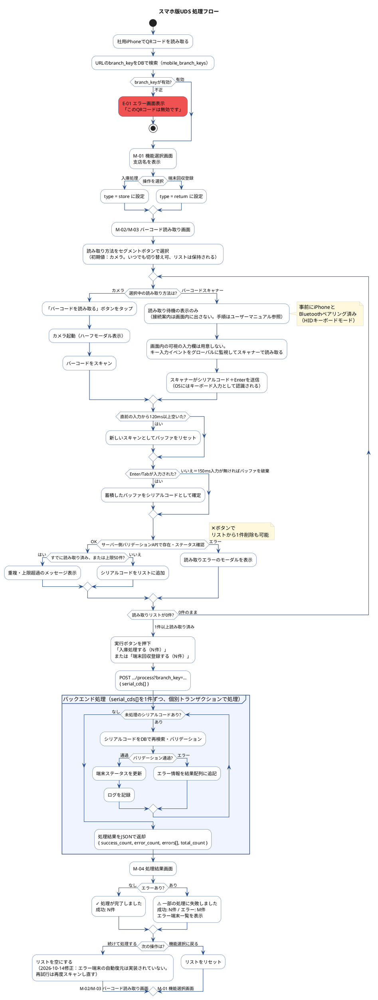

# UX設計：スマホ版UDS — 入庫処理・回収済み処理

**作成日:** 2026-06-01  
**更新：** 2026-10-14 実装コードのレビュー結果を反映し、URL・画面構成・トークン方式・キャンセル返却予定端末の扱い・回収報告コメント・Bluetooth接続案内の扱いを実装内容に合わせて全面修正
**前提:**
- デバイス：社用iPhone（iOS Safari）
- アクセス：VPN（AnyConnect）経由、QRコード読み取りでURLへアクセス
- バーコード読み取り：カメラAPI、またはBluetoothバーコードスキャナー（HIDキーボードエミュレーションモード）のどちらか（併用可）。実機検証でカメラでは小型バーコードを読み取れない可能性が判明したため、2026-09にBluetoothスキャナー対応を追加
- 一括処理：複数読み取り後、ボタン押下で一括実行
- エラー時：エラー端末のみ報告し、成功分は処理を確定する

---

## 1. 画面一覧

| 画面ID | 画面名 | URL |
|--------|--------|-----|
| M-01 | 機能選択画面 | `/mobile/branch/menu?branch_key={支店ごとの不透明なランダムキー}`（`branch_cd`は直接URLに含めない。詳細は開発概要書「QRコードURLのアクセストークン化」参照） |
| M-02 | バーコード読み取り画面（入庫処理） | `/mobile/branch/scan/store/scan?branch_key=...`（入庫処理専用の別画面。2026-10-14修正：当初案のSPA1ページ構成ではなく、処理種別ごとに別エンドポイントを持つ構成で実装された） |
| M-03 | バーコード読み取り画面（端末回収登録） | `/mobile/branch/scan/return/scan?branch_key=...`（回収登録専用の別画面） |
| M-04 | 処理結果画面 | M-02/M-03と同一ページ内でJSにより切り替え表示。一括実行API（`.../process`）のJSONレスポンスを元に描画 |
| E-01 | エラー画面（branch_key不正） | `/mobile/branch/error`。各画面でサーバー側が`branch_key`を検証し、不正時にリダイレクト |

---

## 2. 画面遷移図

```
QRコード読み取り
      │
      ▼
  [M-01] 機能選択画面
  ○○支店であることを確認
      │
      ├─── 「入庫処理」押下 ────────► [M-02] バーコード読み取り（入庫処理）
      │                                          │
      └─── 「端末回収登録」押下 ───────► [M-03] バーコード読み取り（回収済み）
                                                 │
                                    （共通）      │ 「実行」ボタン押下
                                                 ▼
                                          [M-04] 処理結果画面
                                                 │
                                    ┌────────────┴───────────┐
                                    │                         │
                              「続けて処理する」         「機能選択に戻る」
                                    │                         │
                              [M-02/03] に戻る          [M-01] に戻る
                              （リストは空の状態で再表示。2026-10-14修正：
                               エラー端末の自動復元は実装されていない）
```

---

## 2-1. 処理フロー図（PlantUML）



---

## 3. 各画面のワイヤーフレーム

---

### M-01 機能選択画面

```
┌─────────────────────────────────┐
│                                  │
│         ┌──────────┐            │
│         │  UDS ロゴ │            │
│         └──────────┘            │
│                                  │
│  ┌──────────────────────────┐   │
│  │        ○○支店            │   │  ← branch_cdからDB取得した支店名
│  └──────────────────────────┘   │
│                                  │
│  ┌──────────────────────────┐   │
│  │                           │   │
│  │       入庫処理        │   │  ← c-btn is-ok （緑）
│  │                           │   │
│  └──────────────────────────┘   │
│                                  │
│  ┌──────────────────────────┐   │
│  │                           │   │
│  │      端末回収登録       │   │  ← c-btn is-blue （青）
│  │                           │   │
│  └──────────────────────────┘   │
│                                  │
└─────────────────────────────────┘
```

**仕様:**
- `branch_key` に対応する支店が存在しない・無効な場合はエラー画面（E-01）へ遷移
- 支店名は画面上部に常に表示し、誤操作を防ぐ
- ボタンは大きく（タップしやすい高さ 56px 以上）

---

### M-02/M-03 バーコード読み取り画面

読み取り方法（カメラ／Bluetoothスキャナー）は常時両方表示すると分かりにくいため、**画面上部のセグメントボタンで明示的に切り替える**方式に変更した（2026-09見直し）。

**パターンA：「カメラ」選択時（初期状態）**

```
┌─────────────────────────────────┐
│ ← 戻る                           │
│ ○○支店 ／ 入庫処理           │  ← 支店名 + 機能名をヘッダーに表示
├─────────────────────────────────┤
│  読み取り方法                     │
│  ┌────────────┬────────────┐   │
│  │ 📷 カメラ   │ 📡 スキャナー│   │  ← セグメントボタン（トグル）
│  │  （選択中） │            │   │     選択中の方だけ強調表示
│  └────────────┴────────────┘   │
│                                  │
│  ┌──────────────────────────┐   │
│  │                           │   │
│  │    📷 バーコードを        │   │  ← c-btn is-yes（大ボタン）
│  │       読み取る            │   │     タップでカメラ起動
│  │                           │   │
│  └──────────────────────────┘   │
│                                  │
│  読み取り済み（2件）              │  ← 読み取り件数をリアルタイム表示
│  ────────────────────────────   │
│  ┌──────────────────────────┐   │
│  │  ABC123456789    ╳       │   │  ← 読み取ったシリアルコード ＋ 削除ボタン
│  └──────────────────────────┘   │
│  ┌──────────────────────────┐   │
│  │  DEF987654321    ╳       │   │
│  └──────────────────────────┘   │
│                                  │
│  ┌──────────────────────────┐   │
│  │  入庫処理する（2件）  │   │  ← c-btn is-ok （件数が0のときdisable）
│  └──────────────────────────┘   │
└─────────────────────────────────┘
```

**パターンB：「スキャナー」選択時**

（2026-10-14修正：当初案にあった画面内のBluetooth接続案内ブロックは表示しない。ペアリング手順はユーザーマニュアルに記載し、事前にペアリングを済ませておく運用とする）

```
┌─────────────────────────────────┐
│ ← 戻る                           │
│ ○○支店 ／ 入庫処理           │
├─────────────────────────────────┤
│  読み取り方法                     │
│  ┌────────────┬────────────┐   │
│  │ 📷 カメラ   │ 📡 スキャナー│   │
│  │            │  （選択中） │   │
│  └────────────┴────────────┘   │
│                                  │
│  ┌──────────────────────────┐   │
│  │   📡                      │   │  ← タップ可能な入力欄は表示しない
│  │  スキャナーで読み取って   │   │     （手入力の誘因を作らないため）
│  │      ください             │   │     待機状態を示すだけの表示
│  └──────────────────────────┘   │
│                                  │
│  読み取り済み（2件）              │
│  ────────────────────────────   │
│  ┌──────────────────────────┐   │
│  │  ABC123456789    ╳       │   │
│  └──────────────────────────┘   │
│  ┌──────────────────────────┐   │
│  │  DEF987654321    ╳       │   │
│  └──────────────────────────┘   │
│                                  │
│  ┌──────────────────────────┐   │
│  │  入庫処理する（2件）  │   │
│  └──────────────────────────┘   │
└─────────────────────────────────┘
```

**仕様:**

| 項目 | 内容 |
|------|------|
| セグメントボタン | 「📷 カメラ」「📡 スキャナー」の2択。選択中の方を色付きで強調表示。タップで即座に画面下部の内容が切り替わる |
| 初期選択状態 | 「カメラ」を初期選択とする（前回の選択を端末に記憶する等は行わない。画面を開くたびに「カメラ」から始まる） |
| カメラ選択時の表示 | 既存の「バーコードを読み取る」ボタンのみ表示。Bluetooth接続案内は表示しない |
| カメラ起動 | タップするとカメラ起動（ハーフモーダルでカメラプレビューを表示） |
| 読み取り成功時（カメラ） | リストに追加 → カメラ継続起動 |
| スキャナー選択時の表示 | 読み取り待機の表示のみ（2026-10-14修正：接続案内ブロックは画面に表示しない。ペアリング手順はユーザーマニュアルに記載する）。カメラボタンは非表示 |
| 手入力の防止（重要） | タップ可能な入力欄は画面上に一切表示しない（手入力の誘因を作らないため）。実装では専用の入力欄は用意せず、画面全体のキー入力イベントを「スキャナー」選択中のみグローバルに監視し、`input`/`textarea`/`select`等にフォーカスしている場合は無視する。**入力元がスキャナーか手入力かを完全に判別する方法は存在しない**ため、以下の速度チェックで手入力をほぼ確実に排除する：直前の入力から120ミリ秒以上間隔が空いたら新しい読み取りとしてバッファをリセットし、150ミリ秒入力が無ければバッファを破棄する。バーコードスキャナーは1件分の文字列を数十ミリ秒で連続送信するため、人間の入力速度とは明確に区別できる（2026-10-14修正：当初案は「先頭文字からEnterまで300ms」という単一の閾値だったが、実装では上記の2段階の閾値方式になっている） |
| 読み取り成功時（Bluetoothスキャナー） | Enter/Tabキーを検知してバッファを確定 → サーバーの個別バリデーションAPIで存在・ステータスを確認 → OKならリストに追加 |
| 重複読み取り | カメラ・Bluetoothどちらでも、同一シリアルコードを再読み取りした場合はスキップ（リストに追加しない） |
| **一括処理件数の上限** | 読み取りリストは**最大50件**まで。50件に達した状態でさらに読み取ろうとした場合（カメラ・Bluetoothどちらでも）、リストに追加せず「一度に処理できる件数は50件までです」と表示する。⚠️サーバー側（一括実行API）にはこの件数チェックが実装されていない（実装側へ指摘済み。詳細は開発概要書参照） |
| 読み取りリストの扱い | セグメントボタンを切り替えても、読み取り済みリストの内容は保持する（カメラで数件読んだ後にスキャナーへ切り替えて続きを読む、という使い方も可能） |
| 削除ボタン（╳） | リストから1件削除。上限に達していた場合、1件削除すれば再度読み取り可能になる |
| 実行ボタン | 読み取り件数が0件のときは `is-disable` |
| 実行ボタンラベル | 機能に応じて「入庫処理する（N件）」「回収済みにする（N件）」 |
| 実行前確認 | 確認ダイアログは出さない（タップ操作の流れを止めない）※ 処理結果で確認できるため |

---

#### カメラ起動時のハーフモーダル

```
┌─────────────────────────────────┐
│                                  │
│  （背景：読み取り画面）           │
│                                  │
│  ┌──────────────────────────┐   │
│  │  バーコードを読み取って   │   │  ← モーダルタイトル
│  │       ください            │   │
│  │                           │   │
│  │  ┌────────────────────┐  │   │
│  │  │                    │  │   │
│  │  │   [カメラ映像]     │  │   │  ← videoタグでリアルタイムプレビュー
│  │  │   - - - - - - -    │  │   │     中央に読み取り枠（赤線）
│  │  │   |         |    |  │   │
│  │  │   - - - - - - -    │  │   │
│  │  │                    │  │   │
│  │  └────────────────────┘  │   │
│  │                           │   │
│  │  ┌────────────────────┐  │   │
│  │  │     閉じる         │  │   │  ← c-btn is-cancel
│  │  └────────────────────┘  │   │
│  └──────────────────────────┘   │
└─────────────────────────────────┘
```

---

### M-04 処理結果画面

**パターンA：全件成功**

```
┌─────────────────────────────────┐
│ ○○支店 ／ 入庫処理           │
├─────────────────────────────────┤
│                                  │
│       ✓  処理が完了しました       │  ← 緑アイコン
│                                  │
│  ┌──────────────────────────┐   │
│  │  成功   3件               │   │
│  └──────────────────────────┘   │
│                                  │
│  ┌──────────────────────────┐   │
│  │  続けて処理する           │   │  ← c-btn is-ok
│  └──────────────────────────┘   │
│  ┌──────────────────────────┐   │
│  │  機能選択に戻る           │   │  ← c-btn is-cancel
│  └──────────────────────────┘   │
│                                  │
└─────────────────────────────────┘
```

**パターンB：一部エラーあり**

```
┌─────────────────────────────────┐
│ ○○支店 ／ 入庫処理           │
├─────────────────────────────────┤
│                                  │
│    ⚠  一部の処理に失敗しました   │  ← 黄アイコン
│                                  │
│  ┌──────────────────────────┐   │
│  │  成功   2件               │   │
│  │  エラー 1件               │   │  ← エラー件数は赤文字
│  └──────────────────────────┘   │
│                                  │
│  エラーの端末                     │
│  ────────────────────────────   │
│  ┌──────────────────────────┐   │
│  │  XYZ112233445            │   │  ← シリアルコード
│  │  該当のシリアルコードが   │   │  ← エラー理由（既存バリデーション
│  │  見つかりません           │   │     のメッセージをそのまま表示）
│  └──────────────────────────┘   │
│                                  │
│  ┌──────────────────────────┐   │
│  │  続けて処理する           │   │  ← c-btn is-ok
│  └──────────────────────────┘   │
│  ┌──────────────────────────┐   │
│  │  機能選択に戻る           │   │  ← c-btn is-cancel
│  └──────────────────────────┘   │
│                                  │
└─────────────────────────────────┘
```

**（2026-10-14削除）パターンC「要案内あり」について：** 当初案ではキャンセル返却予定端末（`18`）を「要案内」区分として専用表示する想定だったが、実装ではこの区分は存在せず、`18`は他の対象外ステータスと同じ「エラー」としてパターンBの表示に統合される。開発概要書「対象端末ステータス一覧」参照。

---

### E-01 エラー画面（branch_key不正）

```
┌─────────────────────────────────┐
│                                  │
│         ┌──────────┐            │
│         │  UDS ロゴ │            │
│         └──────────┘            │
│                                  │
│    ✕  アクセスできません         │  ← 赤アイコン
│                                  │
│  このQRコードは無効です。         │
│  正しいQRコードから               │
│  アクセスしてください。           │
│                                  │
└─────────────────────────────────┘
```

---

## 4. レイアウト・UIコンポーネント設計方針（2026-10-14、実装に合わせて全面修正）

当初案は既存の`default.php`レイアウトとは別に共通レイアウトファイル（`views/layout/mobile.php`）を新設し、既存の`c-btn`等のCSSクラスを流用する方針だったが、**実装では共通レイアウトファイル・共通CSSファイルのいずれも新設されていない**。各画面（`views/branch/menu/index.php`、`views/branch/scan.php`、`views/branch/error.php`）は、それぞれ`<!doctype html>`から始まる完結したHTMLドキュメントとして実装されており、スタイルも各ファイル内に`<style>`タグでインラインに記述されている（既存PC版の`c-btn`等のクラスは流用していない）。

この方式により、画面間でのCSS・JSの衝突を避けられる一方、スタイルの重複や将来のデザイン変更時の修正箇所が画面ごとに分散するというトレードオフがある。

---

## 5. バーコード読み取り実装方針（カメラ／Bluetoothスキャナー）

### 5-0. Bluetoothスキャナー対応（追加、2026-10-14実装に合わせて修正）

実機検証で、社用iPhoneのカメラでは小型のバーコードを読み取れない可能性が判明したため、BUSICOM BC-BS801D-V2-CWによるBluetooth読み取りにも対応する。

- **接続方式**：Bluetooth HID（キーボードエミュレーション）モード。本製品はデフォルトでHIDモードのため機器側の追加設定は不要
- **アプリ側の実装**：Web Bluetooth API等は使用しない（iOS Safari非対応のため）。当初案は専用の常設テキスト入力欄（`inputmode="none"`）を用意する方式だったが、**実装ではそもそも専用の入力欄を持たない**。「スキャナー」選択中のみ、画面全体の`keydown`イベントをグローバルに監視し、`input`/`textarea`/`select`等にフォーカスしている場合は無視する方式を採用した。スキャナーが送信する文字列をバッファに蓄積し、直前の入力から120ms以上間隔が空いたら新しい読み取りとしてリセット、Enter/Tabキーを検知した時点のバッファをシリアルコードとして確定する（150ms入力が無ければバッファを破棄）
- **事前準備（運用）**：社用iPhoneの「設定」→「Bluetooth」でスキャナーと事前ペアリング。iPhoneのキーボード言語を「英語（米国）」に設定（メーカー仕様）。画面内にはペアリング手順を表示しないため、ユーザーマニュアルを参照する運用とする
- **カメラとの切り替え**：当初案は「カメラボタン」と「Bluetooth入力欄」を同一画面に常時両方表示する方式だったが、2026-09の見直しにより画面上部のトグルボタンで「カメラ」「バーコード（スキャナー）」を明示的に切り替える方式に変更した。「バーコード」選択時のみ上記のキー入力監視が有効になる

### 5-1. カメラAPI実装方針

### ライブラリ選定（要確認）

iOSのSafariは `BarcodeDetector` APIの対応が不安定なため、ライブラリを使用する。

| ライブラリ | iOS Safari対応 | 備考 |
|-----------|---------------|------|
| `@zxing/browser` | ◎（iOS 14.3+） | WebRTC使用。**Code 128対応。採用決定** |
| `quagga2` | ○ | 旧Quaggaの後継。軽量 |
| `html5-qrcode` | ◎ | ラッパーライブラリ。導入が簡単 |

→ **`@zxing/browser` に決定**（バーコード種類：Code 128 確認済み。実機での動作確認は開発時に実施）

**実装メモ（2026-10-14、実装に合わせて修正）：** 当初案は本リポジトリにビルド構成が無いことを前提に、`@zxing/browser`をESモジュール形式のまま手動でベンダリングする方式を想定していた。実際には、このモバイル機能専用に`package.json`＋`esbuild`による簡易ビルドパイプラインが新設されており、`assets-src/barcode-scanner.js`（`@zxing/browser`をimportするソース）を`npm run build`で`src/public_html/public/assets/js/barcode-scanner.js`（IIFE形式・minify済みの単一ファイル）にバンドルする方式になっている。

### 読み取りフロー（JavaScript）

```
1. 「バーコードを読み取る」ボタン押下
        ↓
2. カメラ起動許可ダイアログ（初回のみiOSが表示）
        ↓
3. ハーフモーダル内でカメラプレビュー開始
        ↓
4. バーコード検出
    ├─ 新規シリアルコード → リストに追加 + 効果音/バイブ → カメラ継続
    └─ 重複シリアルコード → トースト「すでに読み取り済みです」→ カメラ継続
        ↓
5. 「閉じる」ボタン押下でモーダルを閉じ、実行ボタン押下へ
```

### 確認が必要な事項

- UDSで使用しているバーコードの種類（Code 128 / Code 39 / その他）
- iOSのSafariのカメラ許可設定（MDM管理端末のため制約がある可能性）
- AnyConnect VPN接続中のカメラAPIへの影響
- Bluetoothスキャナー（BC-BS801D-V2-CW）接続中に、AnyConnect VPN接続やMDM管理端末の制約でBluetooth自体が制限されないか
- Bluetoothスキャナーの送信モード設定（初期値「同期送信」でよいか、「非同期送信」に変更するか）

---

## 6. 新規作成ファイル一覧（2026-10-14、実装に合わせて全面修正）

当初案は承認済みの操作可能モックと同じ**1ページSPA方式**（M-01〜E-01を単一ビューに含める）を想定していたが、実装ではM-01（メニュー）・M-02/M-03（読み取り、処理種別ごとに別コントローラー）・E-01（エラー）がそれぞれ別のコントローラー・ビューを持つ構成になっている。

| 種別 | ファイルパス | 内容 |
|------|------------|------|
| コントローラー基底 | `modules/mobile/classes/controller/branch/base.php` | ビュー描画・JSON応答・支店解決等の共通処理（ログイン機構は持たない） |
| コントローラー（メニュー） | `modules/mobile/classes/controller/branch/scan/menu.php` | M-01相当。`branch_key`を解決してメニュー画面を表示 |
| コントローラー（読み取り基底） | `modules/mobile/classes/controller/branch/scan/base.php` | スキャン画面表示・個別バリデーションAPI・一括実行APIの共通処理（抽象クラス） |
| コントローラー（入庫） | `modules/mobile/classes/controller/branch/scan/store.php` | M-02相当。入庫処理用の薄いサブクラス |
| コントローラー（回収） | `modules/mobile/classes/controller/branch/scan/return.php` | M-03相当。回収登録用の薄いサブクラス |
| コントローラー（エラー） | `modules/mobile/classes/controller/branch/error.php` | E-01相当 |
| エラー処理共通トレイト | `modules/mobile/classes/trait/error/handler.php` | `action_error()`を提供する共通トレイト |
| サービス（支店解決） | `modules/mobile/classes/service/branch.php` | `branch_key`→`branch_cd`→支店情報の解決 |
| サービス（バリデーション） | `modules/mobile/classes/service/branch/validator.php` | 端末ステータス・支店一致・在庫マスタ等の共通バリデーション |
| サービス（スキャン制御） | `modules/mobile/classes/service/branch/scan.php` | 個別・一括処理のラッパー（成功/エラー件数の集計） |
| サービス（入庫処理） | `modules/mobile/classes/service/branch/store.php` | 支店在庫入庫・通常新設入庫の実処理 |
| サービス（回収処理） | `modules/mobile/classes/service/branch/return.php` | 回収済み登録の実処理 |
| モデル（支店キー） | `classes/model/mobile/branch/key.php`（`Model_Mobile_Branch_Key`） | `mobile_branch_keys`テーブルのモデル |
| ビュー（メニュー） | `modules/mobile/views/branch/menu/index.php` | M-01 |
| ビュー（読み取り・結果） | `modules/mobile/views/branch/scan.php` | M-02/M-03/M-04を1ファイルで出し分け（スタイルはインライン） |
| ビュー（エラー） | `modules/mobile/views/branch/error.php` | E-01 |
| JS（カメラ） | `public/assets/js/barcode-scanner.js` | `@zxing/browser`をバンドルしたカメラ読み取り処理（`assets-src/barcode-scanner.js`を`esbuild`でビルド） |
| ビルド設定 | `package.json`（`npm run build`） | `esbuild`による`barcode-scanner.js`のバンドル定義 |

---

## 7. APIエンドポイント（2026-10-14、実装の実際のURL・形式に合わせて全面修正）

| メソッド | URL | 処理 |
|---------|-----|------|
| GET | `/mobile/branch/menu?branch_key=...` | M-01。`branch_key`をサーバー側で検証し、メニュー画面を返す |
| GET | `/mobile/branch/scan/store/scan?branch_key=...`（回収は`scan/return/scan`） | M-02/M-03。読み取り画面を返す |
| POST | `/mobile/branch/scan/store/validate?branch_key=...&format=json`（回収は`scan/return/validate`） | 読み取った1件のシリアルコードの存在・ステータスを検証するAPI（リストに追加する前に都度呼び出す） |
| POST | `/mobile/branch/scan/store/process?branch_key=...&format=json`（回収は`scan/return/process`） | 一括処理実行（JSON API） |
| GET | `/mobile/branch/error` | E-01 |

### POSTリクエスト（個別バリデーションAPI `.../validate`）

```
serial_cd  : 読み取った1件のシリアルコード
```

### レスポンス（個別バリデーションAPI）

```json
{
  "exists": true,
  "serial_cd": "ABC123456789",
  "message": ""
}
```

### POSTリクエスト（一括実行API `.../process`）

```
serial_cds[]  : {シリアルコード1}, {シリアルコード2}, ...
```

`branch_key`はURLクエリパラメータとして渡し、サーバー側で毎回`branch_cd`を再解決する（クライアントから`branch_cd`を直接送信させず、認可チェックの迂回を防止する）。

⚠️**サーバー側に`serial_cds[]`の件数上限チェックは実装されていない**（詳細は開発概要書参照）。

### レスポンス（一括実行API）

```json
{
  "success": false,
  "success_count": 2,
  "error_count": 1,
  "errors": [
    {
      "serial_cd": "XYZ112233445",
      "message": "端末が存在しません。"
    }
  ],
  "total_count": 3
}
```

当初案にあった`notice_count`/`notices[]`は実装されていない。キャンセル返却予定端末（`device_status_cd=18`）は他の対象外ステータスと同じく`errors[]`に含まれる。

---

## 8. 確認事項

| # | 確認内容 | 確認先 |
|---|---------|--------|
| ~~1~~ | ~~UDSのバーコード種類（Code 128 / Code 39等）~~ | **決定：Code 128。`@zxing/browser` 採用** |
| 2 | MDM管理端末（社用iPhone）でSafariのカメラAPIが使用可能か | インフラ・MDM管理者 |
| 3 | AnyConnect VPN接続中にカメラAPIが制限されないか | インフラ担当 |
| ~~4~~ | ~~既存のバリデーションエラーメッセージの一覧~~ | **決定：下表参照** |
| ~~5~~ | ~~「続けて処理する」でリセット時、エラー端末も再度リストに含めるか？~~ | 当初「エラー端末をリストに復元する」と決定していたが、**実装ではリストを空にして再表示するのみで、復元機能は無い**（2026-10-14、実装に合わせて修正） |
| ~~6~~ | ~~別支店操作リスクへのアクセス制御方針（認証なし vs IPアドレス制限等）~~ | **決定：認証は追加せず、URLを不透明なランダムキー（`branch_key`）化することで他支店URLの推測・総当たりを防止する（開発概要書「QRコードURLのアクセストークン化」参照）** |
| ~~7~~ | ~~Bluetoothスキャナーの機種選定・接続方式（HIDモード対応か）~~ | **決定：BUSICOM BC-BS801D-V2-CW、Bluetooth HIDモード（デフォルト設定）で対応可能と確認済み** |
| 8 | Bluetoothスキャナーの配布台数・予算・調達（全支店必須配備か任意の代替手段か） | 越智さん・調達担当 |

### バリデーションエラーメッセージ一覧（2026-10-14、実装の実態に合わせて修正）

処理結果画面のエラー端末一覧に表示するメッセージ。当初案は既存の`fuel/app/config/define.php`の定数をすべて再利用する方針だったが、実装では一部のみ既存定数が使われ、他は新規に似た文言のメッセージがハードコードされている。**この不統一は実装側へ指摘済み**（既存定数に寄せるべきかの判断待ち）。

| メッセージ | 実装での扱い | 発生条件 | 対象処理 |
|-----------|------------|---------|---------|
| 「端末が存在しません。」 | 新規文言（既存の`SERIAL_NOTHING_MSG`は未使用） | DBにシリアルが存在しない | 入庫・回収 |
| 「端末の管轄が異なります。現在の管轄：{支店名}」 | 新規文言（既存の`SERIAL_WRONG_BRANCH_MSG`は未使用） | 別支店の端末を読み取った | 入庫 |
| 「端末ステータスが異なります。現在のステータス：{ステータス名}」 | 新規文言（既存の`SERIAL_UPDATE_MSG`は未使用）。`18`キャンセル返却予定・`19`顧客出庫もこのメッセージになる | 端末ステータスが処理対象外 | 入庫・回収 |
| `CONTRACT_UPDATE_MSG`（契約情報が更新されました。お手数ですが、最初からやり直してください。） | 既存定数をそのまま使用 | 契約ステータスが「受注」以外 | 入庫（通常新設） |
| 「支店管轄と型番に紐づく支店在庫マスタの登録がありません。支店cd：{branch_cd}　型番：{型番}」 | 新規文言（既存の`NO_HEAD_BRANCH_STOCK_MSG`は未使用） | 支店在庫マスタ未登録 | 入庫（支店在庫） |
| 「依頼が存在しません。」 | 新規文言 | 回収依頼（`shipping_requests`）が見つからない | 回収 |
| 「入庫処理に失敗しました。」／「回収済み登録に失敗しました。」 | 新規文言 | システムエラー（例外発生） | 入庫・回収 |

**2026-10-14時点で未実装のメッセージ：** `SERIAL_SHIP_CUSTOMER_MSG`相当（顧客出庫ステータス専用メッセージ）、`SET_INCOMPLETE_MSG`（セット商品不足）、キャンセル返却予定端末専用の「要案内」メッセージは、いずれも専用の分岐が実装されておらず、上記「端末ステータスが異なります」の汎用メッセージに統合されている。
