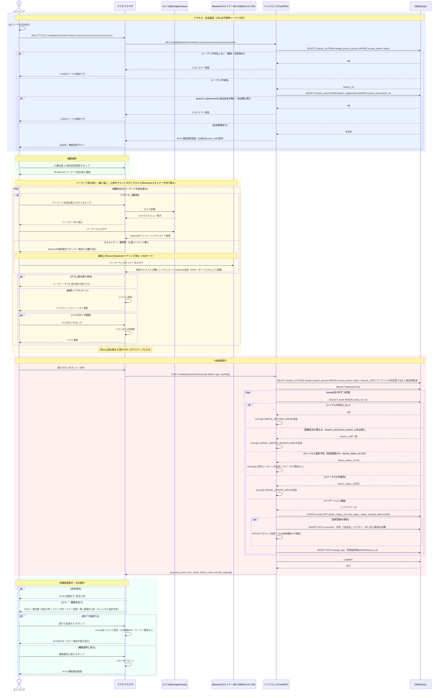

# 開発概要：スマホ版UDS — 支店在庫入庫・回収済み処理

**作成日:** 2026-06-01

---

## 1. 背景・課題

### 現状フロー

各支店の在庫担当者がUDSを立ち上げ、1台ずつバーコードを読み取って「支店在庫入庫」処理を実施している。

### 課題

| # | 課題 | 詳細 |
|---|------|------|
| ① | 業務負荷の集中 | 在庫担当者は日中外作業のため、帰社後（18〜19時以降）の夜間処理になり残業が常態化 |
| ② | 属人化 | 地方の小規模支店では在庫担当者が1名のみ。休むと処理が滞留 |
| ③ | 内部監査指摘 | 受け入れ処理の未実施が指摘されており、業務改善が急務 |

### UF側からの要望

- 在庫担当者以外でも支店在庫入庫作業が可能な状態にする
- UDSへのログイン・PC立ち上げを不要にし、現場のスマホ等で完結させたい

### 追加課題：カメラでの小型バーコード読み取り（2026-09判明）

実機検証の過程で、社用iPhoneのカメラでは小さいバーコード（型番によっては）を読み取れない可能性があることが判明した。カメラのみに依存すると、一部端末で入庫・回収処理ができなくなるリスクがあるため、Bluetoothバーコードスキャナーとの併用に対応する（詳細は「3. 機能仕様」内の「バーコード読み取り方式」を参照）。

---

## 2. 開発概要

### 採用方式：社用iPhone + QRコードアクセス

UFのエンジニア全員に配布されている社用iPhoneを活用する。UDSに支店ごとの専用URLを用意し、スマホでQRコードを読み取ってアクセスする。AnyConnect（VPN接続アプリ）を使うことでUDSに社内ネットワーク通信する仕組みを構築する。

### 業務フロー（新）

```
① エンジニアが社用iPhoneで、各支店に配布されたQRコードを読み取る
          ↓
② UDSのスマホ版ページが表示される
   例）https://mobile.uds.usen.co.jp/mobile/branch/store?token=xxxxxxxxxxxxxxxxxxxxxxxxxxxxxxxx
   （支店コードを直接使わず、支店ごとの不透明トークンでアクセスする。詳細は「3. 機能仕様」参照）
          ↓
③ バーコードを読み取る（複数端末がある場合は連続で読み取る）
   カメラ読み取り、またはBluetoothバーコードスキャナー読み取りのどちらでも可（併用可）
          ↓
④ 「入庫処理」または「端末回収登録」ボタンを押下
          ↓
⑤ 対象支店の処理が一括実行される
```

### メリット・デメリット

| 観点 | 内容 |
|------|------|
| ✅ センター作業不要 | 現場で即時処理が完結 |
| ✅ リアルタイム性 | 帰社後の夜間処理が不要になる |
| ✅ 誰でも操作可能 | 専用画面のためUDS全体の習熟が不要 |
| ✅ PCレス | PCの起動・ログインが不要 |
| ✅ 中間ファイル不要 | スプシ等を介さない |
| ✅ 社外作業対応 | VPN利用でセキュリティを担保 |
| ⚠️ URL分離が必要 | 既存URLとのサブドメイン分離が必要 |
| ⚠️ QRコード配布の手間 | 支店ごとにQRコードを生成・配布する運用が必要 |
| ⚠️ URLを知っている人は誰でも使える | 認証は行わないため、有効なURL（トークン）を知っていれば操作できる。ただしトークンを不透明化したことで、他支店URLの推測・総当たりによる操作は防止している（詳細は「3. 機能仕様」参照） |
| ⚠️ 開発・インフラ工数 | 既存と比較して工数が大きい |

---

## 3. 機能仕様

### 提供機能

| 機能 | 概要 |
|------|------|
| 入庫処理 | バーコードを読み取った端末をまとめて支店在庫入庫処理する |
| 端末回収登録 | バーコードを読み取った端末をまとめて回収済みに変更する |

### 仕様ポイント

- 処理・バリデーションは現状と変更なし
- スマホ版では複数端末の**一括処理**に対応（バーコードを連続で読み取ってからボタン押下）
- 既存の入庫処理・回収済み機能は閉じず、処理の変更もなし

### モバイル版固有の仕様（ログインなしのための調整・確定事項）

既存のPC版はログインセッション（管轄支店・操作者）を前提とした処理だが、モバイル版はログインを行わないため、以下の通り調整する。

| 項目 | 仕様 |
|------|------|
| 支店一致チェック（入庫処理） | 既存はログインユーザーの管轄支店（`Common_User::get('jurisdiction_branch_cd')`）と端末の`device_branch_cd`を比較しているが、モバイル版はQRコードの`token`から解決した支店の`branch_cd`と端末の`device_branch_cd`を比較する |
| 回収登録の対象端末 | 既存同様、回収依頼中（`20`/`21`）・回収不可（`23`）・キャンセル返却予定（`18`）のいずれかの端末のみ処理対象（回収依頼が起票されていない端末はエラー：`SERIAL_UPDATE_MSG`） |
| 回収報告氏名 | 入力欄を設けず、`「{支店名}（スマホ）」`を自動設定して`Model_Comment`に記録する |
| 申し送り事項 | 入力欄を設けず、空欄で登録する |
| PPPoEアカウント削除／UDS検証機紐づけ解除 | 既存同様に実施する |
| キャンセル返却予定端末（`18`）の扱い | エラーにはせず、「要案内」区分として結果画面に表示する（ステータス更新は行わない）。返却先名称・住所は表示しない（マスタの返却先項目は現状未使用のため）。メッセージのみ表示 |
| ログ記録の実施者情報 | `Common_Logger::change_log`等の実施者情報は、ログインユーザーIDの代わりにQRの`token`から解決した`branch_cd`を記録する |

### QRコードURLのアクセストークン化（2026-09追加、09-30設計見直し）

**背景：** モバイル版はログインを行わないため、URLの`branch_cd`パラメータさえ分かれば誰でもその支店の操作ができてしまう。特に、支店コードは命名規則が推測しやすく、他支店のQRコードを見たことがなくても値を書き換えるだけで別支店にアクセスできてしまう点がリスクだった（開発概要書の確認事項①）。これに対応するため、URLに支店コードを直接載せず、支店ごとに発行する不透明なランダムトークンでアクセスする方式に変更する。

**保持先について（09-30見直し）：** 当初`branch_replacement`テーブル（管轄支店倉庫置換マスタ）に列追加する案としていたが、**同テーブルは`branch_cd`にユニーク制約が無く、1つの`branch_cd`に複数行が存在しうる**ことが判明した（`unis_branch_cd`違いで同じ`branch_cd`に複数行が紐づく、という業務上正当な重複。UNIS側の複数拠点がUDS上は1つの`branch_cd`に集約されるケース）。そのため、このテーブルに直接トークンを持たせると「同じ支店の複数行のうち、どれが正のトークンか」が曖昧になる。この問題を避けるため、**モバイル版専用の新規マスタテーブルを1つ新設**し、そちらでトークンを一意に管理する方式に変更した。

※なお、既存のQR検証ロジック（`branch_cd`で`branch_replacement`を検索していた元の実装）も同じ非一意性の影響を受けており、`get_one()`がどの行を返すか不定という問題を元々抱えていた。今回の新規テーブル化によりモバイル版はこの問題から切り離されるが、`branch_replacement`自体の重複データ整理は本改修のスコープ外とする（必要であれば別途対応）。

| 項目 | 内容 |
|------|------|
| トークンの保持先 | 新規テーブル`mobile_branch_access`（仮称）を新設。列：`id`, `branch_cd`（ユニーク）, `access_token`（ユニーク）, `created_at`, `updated_at`, `deleted_at`。**`branch_name`は持たせない**（`branch_replacement`側が正のデータであり、二重管理・更新漏れを避けるため。表示用の支店名は都度`branch_replacement`を`branch_cd`で引く） |
| トークンの生成方法 | 暗号学的に安全な乱数（例：`random_bytes(16)`を16進数化した32文字＝128bit相当）を発行する |
| レコードの新規作成・自動同期 | **`branch_replacement`への新規登録経路はPC管理画面「その他マスタ」のCSV一括アップロード（`Controller_Master_Other::action_branch_replacement_upload_csv()`）のみ**であることを確認した。このCSV保存処理の直後に、同期処理を1つ追加する：`branch_replacement`から`branch_cd`単位で集約したリストを取得し、`mobile_branch_access`に**存在しない**`branch_cd`だけ新規トークンを発行してINSERTする（`branch_name`は保持しないため更新処理も不要）。これにより、CSVで新しい`branch_cd`が登録されるたびに、UDS開発側が手を動かさなくても自動的にモバイル版のアクセス権が発行される |
| 管理画面（UI）について | 上記の自動同期により、**通常運用でUIによる個別登録は不要**になった。トークンの手動再発行（後述）のみ、UDS開発側がSQLで直接対応する |
| QRコードURL | `https://mobile.uds.usen.co.jp/mobile/branch/store?token=<トークン>`（`branch_cd`は含まない） |
| サーバー側の検索ロジック | `action_index()`（初期画面表示）・`action_execute()`（一括実行API）の両方で、まず`mobile_branch_access`を`access_token`で検索して`branch_cd`を取得し、続けてその`branch_cd`で`branch_replacement`を検索して`branch_name`（表示用）を取得する2段階の解決を行う。`branch_replacement`側にその`branch_cd`が見つからない場合（支店廃止等）はエラー扱いとする。**`action_execute()`もクライアントから受け取った`branch_cd`をそのまま信用せず、`token`から毎回サーバー側で支店を再解決する**（`branch_cd`を直接POSTされて認可チェックを迂回されないようにするため） |
| トークンの再発行（漏洩時等） | 自動同期は「新規`branch_cd`の追加」のみを行い、既存トークンの失効は対象外のため、漏洩時の再発行はUDS開発側が手動でDBを操作して対応する。無効化のタイミングは以下のいずれかをケースに応じて選択する：①即座に旧レコードを削除する（対応は早いがQR再配布までその支店は利用不可になる）②新トークンのレコードを追加したうえで旧レコードをしばらく残し、QR再配布・周知が完了してから旧レコードを削除する（移行期間を設ける） |
| 影響範囲 | QRコードはまだ配布前のため、配布開始前にこの変更を反映すれば、配布済みQRコードの回収・再配布は発生しない |

### 入庫処理：通常新設出庫（追加対応）

当初は「支店在庫出庫（ステータス`9`）→支店在庫入庫」のみを対象としていたが、「通常新設出庫（ステータス`10`）→通常新設入庫」もモバイル版の対象に追加した。既存PC版（`Controller_Branch_Device_Store::action_search_barcode()` / `action_store_save($request_type_cd=1)`）と同等の機能を持たせる。

| 項目 | 仕様 |
|------|------|
| 対象出荷依頼の特定 | スキャンしたシリアルコード・契約CD・出荷依頼種別（通常新設）から、既存と同じ共通クエリ（`Manage\Common_Shipping_Request`）で出荷依頼明細を特定する |
| 契約ステータスチェック | 契約が「受注」ステータスでない場合は`CONTRACT_UPDATE_MSG`エラーとする |
| セット商品（同一顧客・同一依頼日・同一セットCDの複数明細）の扱い | セット内の物理バーコードが必要な明細（ダミーシリアル以外）が、**同じ一括実行バッチ内に全てスキャンされていること**を要求する。不足がある場合は新規メッセージ`SET_INCOMPLETE_MSG`（不足している型番を含む）でエラーとする。PC版は複数回のスキャンで進捗をサーバー側に引き継ぎながら確認する方式だが、モバイル版は「まとめてスキャンしてから一括実行」という設計のため、事前に全部スキャンしておく方式に置き換えている（完了条件＝セット内の全明細が揃うことは同じ） |
| ダミーシリアル（`uds_non_target_flg`＝シリアル管理対象外）の扱い | 物理バーコードが存在しないため、バーコードのスキャンなしで自動的に完了扱いとする（PC版と同じ） |
| キャンセル返却予定端末（`18`）の扱い | 入庫処理でも回収処理と同様、エラーにせず「要案内」として新規メッセージ`DEVICE_CANCEL_RETURN_STORE_MSG`を表示する（ステータス更新は行わない） |

**既存コードの不具合について：** 調査の過程で、PC版の`action_store_save()`にて契約ステータスが「受注」でない場合（`CONTRACT_UPDATE_MSG`）、エラーメッセージ設定後に`return`が無く処理が続行してしまう（＝エラー表示されても端末情報が更新されてしまう）不具合の疑いを発見した。モバイル版では正しく処理を中断する実装とした（PC版側の修正は本改修のスコープ外、別途報告済み）。

### バーコード読み取り方式（カメラ／Bluetoothスキャナー併用）

社用iPhoneのカメラでは、印字の小さいバーコードを読み取れない可能性があることが実機検証で判明したため、カメラ読み取りに加えてBluetoothバーコードスキャナーによる読み取りにも対応する。

**UI方針（2026-09見直し）：** 当初は「カメラボタン」と「Bluetooth入力欄」を画面に常時両方表示する案としていたが、分かりにくいとのフィードバックを受け、**画面上部のセグメントボタン（「📷 カメラ」「📡 スキャナー」）で読み取り方法を明示的に切り替える**方式に変更した。「スキャナー」選択時は、Bluetooth接続手順（ペアリング案内）を画面内に表示する。詳細はUX設計書のM-02/M-03ワイヤーフレームを参照。

| 項目 | 内容 |
|------|------|
| 採用機種 | BUSICOM BC-BS801D-V2-CW（1次元バーコードリーダー、抗菌仕様） |
| 対応バーコード | Code128含む主要な1次元バーコード（UDSのバーコード形式：Code128と適合） |
| 接続方式 | Bluetooth HID（キーボードエミュレーション）モード。本製品の初期設定（デフォルト）がHIDモードのため、機器側の追加設定は不要 |
| アプリ側の実装方針 | Web Bluetooth API等は使用しない（iOS Safariは非対応のため利用不可）。HIDモードでは、スキャナーが読み取った文字列をOSレベルでキーボード入力として送信するため、「スキャナー」選択中は常にフォーカスされた入力欄を用意するだけでよい。読み取り完了時にEnterキーが付加される仕様（初期値）を利用し、Enter押下をトリガーに読み取りリストへ追加する |
| 手入力の防止（重要） | 画面上にタップ可能な入力欄を表示しない（手入力の誘因を作らないため）。実際の入力を受け取る欄は非表示にして裏側で常時フォーカスしておく。**入力元がスキャナーか手入力かを完全に判別する方法は存在しない**ため、速度チェックで代替する：先頭文字の入力からEnterまでの合計時間が300msを超えた場合は手入力とみなし、エラー表示せず黙って破棄する（バーコードスキャナーは数十msで送信するため人間の入力速度と明確に区別できる） |
| 画面内の接続案内 | 「スキャナー」選択時、画面内にBluetoothペアリング手順（設定アプリでの接続方法）を表示する。アプリ側からペアリング済みかどうかは検知できないため、あくまで案内であり、確認後は折りたたんで閉じられるようにする |
| 事前準備（運用） | 社用iPhoneの「設定」→「Bluetooth」画面でスキャナーと事前ペアリングする（初回のみ、SCANボタン3秒長押しで機器の電源投入→ペアリング一覧から`BS80+XXXX`を選択）。iPhoneのキーボード言語を「英語（米国）」に設定する必要がある（メーカー仕様） |
| 留意事項 | 初期設定の送信モードは「同期送信」のため、Bluetooth圏外（スキャナーとiPhoneの接続が切れた状態）で読み取るとデータが失われる。支店内での利用を想定しており通常は問題ないが、運用上の注意点としてマニュアルに明記する |

---

## 4. インフラ設計（暫定）

### FQDN

| 環境 | FQDN |
|------|------|
| 検証 | `mobile-stg.uds.usen.co.jp` |
| 本番 | `mobile.uds.usen.co.jp` |

- 社内DNSに登録する

### アクセス経路

```
社用iPhone → AnyConnect(VPN) → 社内LAN → TGW → UDS（EC2）※Publicサブネット
```

- TGWは社内LANのソースIPのレンジで許可する

### EC2

| 環境 | 情報 |
|------|------|
| uds_staging | 52.195.73.248 / 10.203.37.203 |
| uds_production | 57.182.37.87 / 10.203.37.24 |

- 両環境ともPublicサブネットに配置
- VPC: `uds-vpc (vpc-0b5e1a572b65c8a58)`

### VPC

| 項目 | 値 |
|------|-----|
| VPC | uds-vpc (`vpc-0b5e1a572b65c8a58`) |
| CIDRブロック | `10.203.37.0/24` |
| ルートテーブル | `uds-vpc-private-route-table` |
| TGWルート | `10.203.44.128/26` → `tgw-00110dd232298b269` |

### サブネット

- `uds-vpc-public-subnet-1a`
- `uds-vpc-public-subnet-1c`
- `uds-vpc-private-subnet-1c`
- `uds-vpc-private-subnet-1d`

### 証明書

- `*.uds.usen.co.jp`（東京リージョン）

---

## 5. 運用設計

### QRコード配布フロー

```
支店の増減発生
      ↓
越智さん → UDS開発側に連絡
      ↓
（新設支店の場合）UDS開発側で「その他マスタ」CSVアップロードにbranch_replacementを登録
      ↓
mobile_branch_accessへのトークン発行は自動同期される（手動DB操作は不要）
      ↓
UDS開発側で、発行されたトークンからQRコード画像を生成・配布
      ↓
Googleドライブに格納・スプレッドシートで一元管理
```

※「支店の増減」のうち支店の新設は、通常`branch_replacement`へのCSV登録を伴うため、その登録さえ行えばモバイル版のトークンは自動的に用意される。QRコード画像の生成（トークンをURLに埋め込んでQR化する作業）自体は引き続き手動対応となる。

### スプレッドシート管理項目

| 項目 |
|------|
| QRコードURL（GoogleドライブのファイルURL） |
| 支店名 |
| 支店コード |
| アクセストークン（下4桁など、識別用に一部のみ記載。トークン全体は外部共有しない） |
| 追加日 |

※QRコードのURL自体にトークンが含まれるため、スプレッドシートやGoogleドライブへのアクセス権限も、支店コード管理と同等に限定すること。

### Bluetoothバーコードスキャナーの配布・運用（追加）

- 各支店に社用iPhoneとペアで、BUSICOM BC-BS801D-V2-CWを配布する（配布台数・予算は要確認、確認事項参照）
- 初回セットアップ時に、社用iPhone側で「設定」→「Bluetooth」からスキャナーとペアリングし、iPhoneのキーボード言語を「英語（米国）」に設定する
- カメラのみでも運用は可能なため、Bluetoothスキャナーは「小型バーコードが読み取れない場合の代替手段」という位置づけとし、必須の携行物にはしない（詳細な運用ルールは越智さんと要調整）

---

## 6. 検証・リリース方針

- STG環境の検証には越智さんも参加いただく
- 開発スケジュールが見えたら越智さんに共有する

---

## 7. 確認事項・未決定事項

| # | 内容 | 確認先 |
|---|------|--------|
| ~~1~~ | ~~別支店URLへの操作リスクに対するアクセス制御の要否~~ | **決定：B案（不透明トークン化）採用。URLの`branch_cd`をランダムトークンに置き換え、他支店URLの推測・総当たりを防止する** |
| 2 | 社内DNS登録の手続きと担当 | インフラ担当 |
| 3 | TGW設定・社内LANのソースIPレンジ確認 | インフラ担当 |
| 4 | 開発スケジュール（越智さん共有タイミング） | 開発リード |
| 5 | Bluetoothバーコードスキャナー（BC-BS801D-V2-CW）の配布台数・予算・調達担当 | 越智さん・調達担当 |
| 6 | Bluetoothスキャナーを全支店必須配備とするか、任意の代替手段とするかの運用方針 | 越智さん |

---

## 8. システムフロー図


