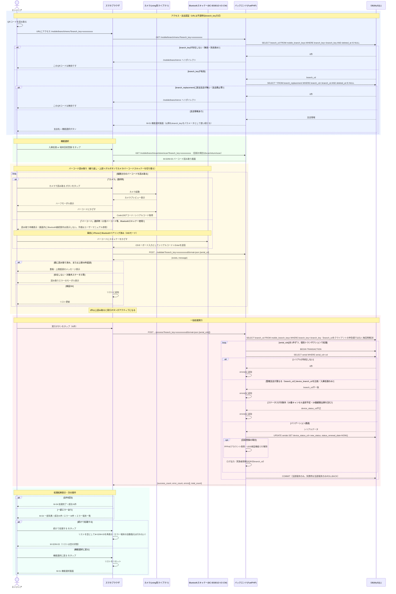

# 開発概要：スマホ版UDS — 入庫処理（支店在庫入庫・通常新設入庫）・回収済み処理

**作成日:** 2026-06-01
**更新：** 2026-10-07 入庫処理の対象に「通常新設入庫」を追加（従来の「支店在庫入庫」のみという記載を見直し）
**更新：** 2026-10-14 実装コードのレビュー結果を反映し、以下を実装内容に合わせて修正（詳細はPRレビューの記録を参照）
  - アクセストークンの方式・テーブル名・URLパラメータ名を、実装（`mobile_branch_keys`／`branch_key`）に合わせて修正
  - キャンセル返却予定端末（`18`）は「要案内」ではなく通常のエラーとして扱われる仕様に修正
  - 回収登録時のコメント登録（`Model_Comment`）は行わない仕様に修正
  - Bluetooth接続案内は画面内表示ではなく、ユーザーマニュアルへの記載に変更

---

## 1. 背景・課題

### 現状フロー

各支店の在庫担当者がUDSを立ち上げ、1台ずつバーコードを読み取って「支店在庫入庫」処理を実施している。

### 課題

| # | 課題 | 詳細 |
|---|------|------|
| ① | 業務負荷の集中 | 在庫担当者は日中外作業のため、帰社後（18〜19時以降）の夜間処理になり残業が常態化 |
| ② | 属人化 | 地方の小規模支店では在庫担当者が1名のみ。休むと処理が滞留 |
| ③ | 内部監査指摘 | 受け入れ処理の未実施が指摘されており、業務改善が急務 |

### UF側からの要望

- 在庫担当者以外でも支店在庫入庫作業が可能な状態にする
- UDSへのログイン・PC立ち上げを不要にし、現場のスマホ等で完結させたい

### 追加課題：カメラでの小型バーコード読み取り（2026-09判明）

実機検証の過程で、社用iPhoneのカメラでは小さいバーコード（型番によっては）を読み取れない可能性があることが判明した。カメラのみに依存すると、一部端末で入庫・回収処理ができなくなるリスクがあるため、Bluetoothバーコードスキャナーとの併用に対応する（詳細は「3. 機能仕様」内の「バーコード読み取り方式」を参照）。

---

## 2. 開発概要

### 採用方式：社用iPhone + QRコードアクセス

UFのエンジニア全員に配布されている社用iPhoneを活用する。UDSに支店ごとの専用URLを用意し、スマホでQRコードを読み取ってアクセスする。AnyConnect（VPN接続アプリ）を使うことでUDSに社内ネットワーク通信する仕組みを構築する。

### 業務フロー（新）

```
① エンジニアが社用iPhoneで、各支店に配布されたQRコードを読み取る
          ↓
② UDSのスマホ版メニュー画面が表示される
   例）https://mobile.uds.usen.co.jp/mobile/branch/menu?branch_key=xxxxxxxxxx
   （支店コードを直接使わず、支店ごとの不透明なランダムキーでアクセスする。詳細は「3. 機能仕様」参照）
          ↓
③ 「入庫処理」または「端末回収登録」を選び、バーコードを読み取る（複数端末がある場合は連続で読み取る）
   カメラ読み取り、またはBluetoothバーコードスキャナー読み取りのどちらでも可（併用可）
          ↓
④ 「入庫処理」または「端末回収登録」ボタンを押下
          ↓
⑤ 対象支店の処理が一括実行される
```

### メリット・デメリット

| 観点 | 内容 |
|------|------|
| ✅ センター作業不要 | 現場で即時処理が完結 |
| ✅ リアルタイム性 | 帰社後の夜間処理が不要になる |
| ✅ 誰でも操作可能 | 専用画面のためUDS全体の習熟が不要 |
| ✅ PCレス | PCの起動・ログインが不要 |
| ✅ 中間ファイル不要 | スプシ等を介さない |
| ✅ 社外作業対応 | VPN利用でセキュリティを担保 |
| ⚠️ URL分離が必要 | 既存URLとのサブドメイン分離が必要 |
| ⚠️ QRコード配布の手間 | 支店ごとにQRコードを生成・配布する運用が必要 |
| ⚠️ URLを知っている人は誰でも使える | 認証は行わないため、有効なURL（トークン）を知っていれば操作できる。ただしトークンを不透明化したことで、他支店URLの推測・総当たりによる操作は防止している（詳細は「3. 機能仕様」参照） |
| ⚠️ 開発・インフラ工数 | 既存と比較して工数が大きい |

---

## 3. 機能仕様

### 提供機能

| 機能 | 概要 |
|------|------|
| 入庫処理 | バーコードを読み取った端末をまとめて入庫処理する。対象は**支店在庫入庫**（支店在庫出庫ステータスの端末）と**通常新設入庫**（通常新設出庫ステータスの端末）の両方（詳細は「3. 機能仕様」参照） |
| 端末回収登録 | バーコードを読み取った端末をまとめて回収済みに変更する |

### 対象端末ステータス一覧

スキャンした端末の`device_status_cd`（端末ステータス）に応じて、以下のいずれかの結果になる。ステータスコードの定義元：`fuel/app/config/define.php`の`device_status`。

| 処理 | 処理前ステータス | 処理後ステータス | 結果区分 | 備考 |
|------|----------------|----------------|---------|------|
| 入庫処理 | `9` 支店在庫出庫 | `11` 支店在庫入庫 | 成功 | 支店在庫マスタ（`head_branch_stock`）の在庫数を+1する |
| 入庫処理 | `10` 通常新設出庫 | `12` 通常新設入庫 | 成功 | 契約ステータスが「受注」であること、セット商品の場合は同一バッチ内に残り明細が揃っていることが条件（「入庫処理：通常新設出庫」参照） |
| 入庫処理 | 上記以外（`1`〜`8`,`14`〜`26`等。`18`キャンセル返却予定を含む） | 変更なし | エラー | 端末ステータスが異なる旨のエラーメッセージ（対象外ステータス） |
| 端末回収登録 | `20` 回収依頼 | `22` 回収済 | 成功 | PPPoEアカウント削除・UDS検証機紐づけ解除を実施 |
| 端末回収登録 | `21` 差し戻し（再回収依頼） | `22` 回収済 | 成功 | 同上 |
| 端末回収登録 | `23` 回収不可 | `22` 回収済 | 成功 | 同上（再度の回収登録を許容） |
| 端末回収登録 | 上記以外（`18`キャンセル返却予定・`19`顧客出庫を含む） | 変更なし | エラー | 端末ステータスが異なる旨のエラーメッセージ（対象外ステータス、または回収依頼が起票されていない） |
| 入庫・回収共通 | シリアルコードがDBに存在しない | - | エラー | 「端末が存在しません。」 |
| 入庫処理のみ | 端末の管轄支店とQRコードの支店が不一致 | - | エラー | 「端末の管轄が異なります。」（回収処理は管轄支店チェックを行わない。既存PC版と同じ仕様） |

**補足（2026-10-14修正）：** キャンセル返却予定端末（`18`）は、当初「要案内」として専用メッセージを表示する方針だったが、実装では他の対象外ステータスと同様の通常エラーとして扱われている。本書はこれに合わせて修正した。また、エラーメッセージは既存PC版の定数（`SERIAL_NOTHING_MSG`等）を再利用せず、実装側で新規に似た文言のメッセージが作成されている。既存定数の再利用については実装側へ別途指摘済み。

### 仕様ポイント

- 処理・バリデーションは現状と変更なし
- スマホ版では複数端末の**一括処理**に対応（バーコードを連続で読み取ってからボタン押下）
- **一括処理は1回あたり最大50件まで**とする。51件目以降はスキャンしても読み取りリストに追加されず、画面上に「一度に処理できる件数は50件までです」と表示する
  - ⚠️**既知の未実装事項（2026-10-14指摘済み）**：クライアント側（画面JS）には50件の上限チェックが実装されているが、サーバー側の一括実行処理には件数チェックが実装されていない。クライアント側の制御を迂回した場合（直接APIを呼び出す等）、51件以上でも無制限に処理されてしまう。実装側に対応を依頼済み
- 既存の入庫処理・回収済み機能は閉じず、処理の変更もなし

### モバイル版固有の仕様（ログインなしのための調整・確定事項）

既存のPC版はログインセッション（管轄支店・操作者）を前提とした処理だが、モバイル版はログインを行わないため、以下の通り調整する。

| 項目 | 仕様 |
|------|------|
| 支店一致チェック（入庫処理） | 既存はログインユーザーの管轄支店（`Common_User::get('jurisdiction_branch_cd')`）と端末の`device_branch_cd`を比較しているが、モバイル版はQRコードの`branch_key`から解決した支店の`branch_cd`と端末の`device_branch_cd`を比較する |
| 回収登録の対象端末 | 既存同様、回収依頼中（`20`/`21`）・回収不可（`23`）のいずれかの端末のみ処理対象（回収依頼が起票されていない端末、およびキャンセル返却予定`18`を含むそれ以外のステータスはエラー） |
| 回収報告のコメント登録 | **行わない**（`Model_Comment`への登録処理自体が無い）。既存PC版は回収報告氏名・申し送り事項をコメントとして記録するが、モバイル版ではこの記録を省略する仕様とする（2026-10-14、実装に合わせて確定） |
| PPPoEアカウント削除／UDS検証機紐づけ解除 | 既存同様に実施する |
| ログ記録の実施者情報 | `Common_Logger`等の実施者情報は、ログインユーザーIDの代わりにQRの`branch_key`から解決した`branch_cd`を記録する |

### QRコードURLのアクセストークン化（2026-09追加、2026-10-14実装内容に合わせて全面改訂）

**背景：** モバイル版はログインを行わないため、URLの`branch_cd`パラメータさえ分かれば誰でもその支店の操作ができてしまう。特に、支店コードは命名規則が推測しやすく、他支店のQRコードを見たことがなくても値を書き換えるだけで別支店にアクセスできてしまう点がリスクだった（開発概要書の確認事項①）。これに対応するため、URLに支店コードを直接載せず、支店ごとに発行する不透明なランダムキーでアクセスする方式とした。

**保持先：** `branch_replacement`テーブル（管轄支店倉庫置換マスタ）は`branch_cd`にユニーク制約が無く、1つの`branch_cd`に複数行が存在しうる（`unis_branch_cd`違いで同じ`branch_cd`に複数行が紐づく、という業務上正当な重複）ため、このテーブルに直接キーを持たせず、**モバイル版専用の新規マスタテーブル`mobile_branch_keys`**でキーを一意に管理する。

| 項目 | 内容 |
|------|------|
| キーの保持先 | 新規テーブル`mobile_branch_keys`。列：`id`, `branch_cd`, `branch_key`, `created_at`, `updated_at`, `deleted_at`。`branch_name`は持たせない（`branch_replacement`側が正のデータであり、二重管理・更新漏れを避けるため。表示用の支店名は都度`branch_replacement`を`branch_cd`で引く） |
| キーの生成方法 | 英数字10桁のランダム文字列（`Common_Util::random_string(10)`）。`branch_key`にDB側でユニーク制約があり、生成時に重複（MySQLエラー1062）が発生した場合は最大3回まで再生成する |
| レコードの自動同期（追加のみ） | `branch_replacement`への登録・更新の経路はPC管理画面「その他マスタ」のCSV一括アップロード（`Upload_Csv_Master_Branch_Replacement`）のみ。このCSV保存処理（`save_line()`）で1行（＝1つの`unis_branch_cd`）を登録・更新するたびに、対象`branch_cd`について`mobile_branch_keys`に有効なレコードが無ければ新規発行する。**既に有効なレコードがあれば何もしない（重複発行はしない）** |
| 削除（廃止支店の無効化）について | **自動では行われない。**`branch_replacement`からある`branch_cd`の全行が論理削除されても、対応する`mobile_branch_keys`のレコードは無効化されずそのまま有効であり続ける。無効化が必要な場合はUDS開発側がSQLで手動対応する |
| `branch_cd`再利用時の挙動（2026-10-15、意図した仕様と確認） | 削除の自動同期を持たないのは意図した設計である。マスタの更新運用上、`branch_replacement`のレコードを一旦削除し、同じ`branch_cd`で内容を登録し直すケース（同一支店の情報訂正等）があり得るため、削除を検知して自動的にキーを無効化する仕組みにすると、こうした通常のマスタ訂正のたびに誤って有効なQRコードを失効させてしまうリスクの方が大きいと判断した。この結果として、一度廃止した`branch_cd`が将来**別の**支店として再利用された場合、廃止前に配布済みの古いQRコード（古い`branch_key`）がそのまま新しい支店に対して有効になってしまう可能性は残るが、これは許容したトレードオフである。支店を完全に廃止し、かつ`branch_cd`の再利用が見込まれる場合は、「5. 運用設計」のQRコード配布フローの通り、UDS開発側が手動でキーを無効化する運用でカバーする |
| 管理画面（UI）について | 通常運用はCSVアップロードに伴う自動発行のみで完結し、個別のUI登録・削除は無い。無効化・再発行はUDS開発側がSQLで直接対応する |
| QRコードURL | `https://mobile.uds.usen.co.jp/mobile/branch/menu?branch_key=<キー>`（`branch_cd`は含まない） |
| サーバー側の検索ロジック | 各画面・API（メニュー表示／バーコード読み取り画面／個別バリデーションAPI／一括実行API）で、まず`mobile_branch_keys`を`branch_key`で検索して`branch_cd`を取得し、続けてその`branch_cd`で`branch_replacement`を検索して支店情報を取得する2段階の解決を行う。`branch_replacement`側にその`branch_cd`が見つからない場合（支店廃止等）はエラー扱いとする。一括実行APIもクライアントから受け取った`branch_cd`をそのまま信用せず、`branch_key`から毎回サーバー側で支店を再解決する（認可チェックの迂回を防止） |
| キーの再発行（漏洩時等） | 自動では無効化されないため、漏洩時の再発行・旧キーの失効はUDS開発側が手動でDBを操作して対応する |
| 影響範囲 | QRコードはまだ配布前のため、配布開始前にこの内容を関係者に周知すれば、配布済みQRコードの回収・再配布は発生しない |

### 入庫処理：通常新設出庫（追加対応）

当初は「支店在庫出庫（ステータス`9`）→支店在庫入庫」のみを対象としていたが、「通常新設出庫（ステータス`10`）→通常新設入庫」もモバイル版の対象に追加した。既存PC版（`Controller_Branch_Device_Store::action_search_barcode()` / `action_store_save($request_type_cd=1)`）と同等の機能を持たせる。

| 項目 | 仕様 |
|------|------|
| 対象出荷依頼の特定 | スキャンしたシリアルコード・契約CD・出荷依頼種別（通常新設）から、既存と同じ共通クエリ（`Manage\Common_Shipping_Request`）で出荷依頼明細を特定する |
| 契約ステータスチェック | 契約が「受注」ステータスでない場合は`CONTRACT_UPDATE_MSG`エラーとする |
| セット商品（同一顧客・同一依頼日・同一セットCDの複数明細）の扱い | セット内の物理バーコードが必要な明細（ダミーシリアル以外）が、**同じ一括実行バッチ内に全てスキャンされていること**を要求する。不足がある場合は新規メッセージ`SET_INCOMPLETE_MSG`（不足している型番を含む）でエラーとする。PC版は複数回のスキャンで進捗をサーバー側に引き継ぎながら確認する方式だが、モバイル版は「まとめてスキャンしてから一括実行」という設計のため、事前に全部スキャンしておく方式に置き換えている（完了条件＝セット内の全明細が揃うことは同じ） |
| ダミーシリアル（`uds_non_target_flg`＝シリアル管理対象外）の扱い | 物理バーコードが存在しないため、バーコードのスキャンなしで自動的に完了扱いとする（PC版と同じ） |
| キャンセル返却予定端末（`18`）の扱い | 他の対象外ステータスと同様の通常エラーとして扱う（「3. 機能仕様」の対象端末ステータス一覧を参照） |

**⚠️未実装事項（2026-10-14発見）：** 上記「セット商品の扱い」は実装されていない。実装コード（`Service_Branch_Validator::validate_normal_store_request()`）では、セット内の他明細の揃い確認を一切行わず、スキャンした端末を1件ずつ完全に独立して処理している。PC版（`Controller_Branch_Device_Store::action_search_barcode()`）はセットの全明細が揃うまで実際の保存処理に進めない仕組みになっているのに対し、モバイル版はこの制約が無いため、セットの一部だけをスキャンして実行すると、その一部だけが「成功」として処理され、残りの端末はステータス`10`（通常新設出庫）のまま警告なく取り残される。受領漏れの現場での発見が困難になるリスクがある。

### セット商品チェック（2026-10-15 UIフロー確定：案B＝実行時一括チェック）

スキャン中にリアルタイムで不足を知らせる案（案A）、非ブロッキングの案内バッジ＋実行時最終チェックのハイブリッド案（案C）も検討した上で、**実装コストが低く既存の設計方針と整合する案B（実行時に一括チェックのみ行う）を採用**した。実行前確認ダイアログを出さない（UX設計書の既存方針）とも矛盾しない。

| 項目 | 内容 |
|------|------|
| チェックのタイミング | 一括実行時（`.../process`）のみ。スキャン中の画面・個別バリデーションAPI（`.../validate`）は変更しない |
| セットの特定方法 | 処理対象端末（`device_status_cd=10`）ごとに、PC版と同じ条件（同一`unis_customer_cd`・同一`request_date`（日付部分のみ一致）・同一`set_cd`。`set_cd`は`device_types`テーブル経由で解決）でセットを構成する他の出荷依頼明細を特定する。`set_cd`が無い明細はセット扱いせず単品として処理する（PC版`Common_Shipping_Request::get_set_common_part_query()`と同じロジック） |
| 判定ロジック | セットに属する明細のうち、ダミーシリアル（`uds_non_target_flg`=対象外）以外の明細について、その`serial_cd`が今回の一括実行リクエスト（`serial_cds[]`）に含まれているかを確認する。全て含まれていれば通常通り処理続行（契約ステータス等、既存の他のチェックはそのまま適用）。1つでも不足していれば、その端末を`errors[]`に`SET_INCOMPLETE_MSG`（不足している型番を含む）として追加し、ステータス更新は行わない |
| 画面側の変更 | 無し。既存の結果画面のエラー表示にそのまま乗る |
| PC版との差分（留意事項） | 不足判定は「バッチに含まれているか」のみで行い、含まれている兄弟明細が別の理由（管轄不一致・ステータス不正等）で個別に失敗するかは問わない。モバイル版は各明細を個別トランザクションで処理する設計のため、PC版のような「セット全体がall-or-nothingで保存される」仕組みにはしない（セットの一部は成功し、別の明細だけ失敗するケースがあり得る） |

**出荷依頼の存在チェックについて（2026-10-14調査）：** 当初案にあった「対象出荷依頼の特定」（`serial_cd`+`contract_cd`+`request_branch_cd`+`request_type_cd`での出荷依頼明細の特定）は実装されておらず、契約が「受注」ステータスであることのみがチェックされている。調査の結果、`device_status_cd=10`になる経路はPC側コード上1箇所（出庫処理）に一本化されており、その際に端末の`device_branch_cd`と出荷依頼の`request_branch_cd`が同期される設計になっているため、現状の実装（端末自体の`device_branch_cd`とQRの支店を比較するチェックは別途残っている）で実害のある不具合は確認できなかった。ただし多重防御の一層が失われている点は留意事項として残す。

**既存コードの不具合について：** 調査の過程で、PC版の`action_store_save()`にて契約ステータスが「受注」でない場合（`CONTRACT_UPDATE_MSG`）、エラーメッセージ設定後に`return`が無く処理が続行してしまう（＝エラー表示されても端末情報が更新されてしまう）不具合の疑いを発見した。モバイル版では正しく処理を中断する実装とした（PC版側の修正は本改修のスコープ外、別途報告済み）。

### バーコード読み取り方式（カメラ／Bluetoothスキャナー併用）

社用iPhoneのカメラでは、印字の小さいバーコードを読み取れない可能性があることが実機検証で判明したため、カメラ読み取りに加えてBluetoothバーコードスキャナーによる読み取りにも対応する。

**UI方針（2026-09見直し、2026-10-14再修正）：** 当初は「カメラボタン」と「Bluetooth入力欄」を画面に常時両方表示する案としていたが、分かりにくいとのフィードバックを受け、**画面上部のセグメントボタン（「📷 カメラ」「📡 スキャナー」）で読み取り方法を明示的に切り替える**方式に変更した。Bluetoothペアリング手順の案内は、画面内には表示せず、**ユーザーマニュアルに記載する**（画面はシンプルに読み取り待機の表示のみとする）。詳細はUX設計書のM-02/M-03ワイヤーフレームを参照。

| 項目 | 内容 |
|------|------|
| 採用機種 | BUSICOM BC-BS801D-V2-CW（1次元バーコードリーダー、抗菌仕様） |
| 対応バーコード | Code128含む主要な1次元バーコード（UDSのバーコード形式：Code128と適合） |
| 接続方式 | Bluetooth HID（キーボードエミュレーション）モード。本製品の初期設定（デフォルト）がHIDモードのため、機器側の追加設定は不要 |
| アプリ側の実装方針 | Web Bluetooth API等は使用しない（iOS Safariは非対応のため利用不可）。HIDモードでは、スキャナーが読み取った文字列をOSレベルでキーボード入力として送信するため、「スキャナー」選択中は常にフォーカスされた入力欄を用意するだけでよい。読み取り完了時にEnterキーが付加される仕様（初期値）を利用し、Enter押下をトリガーに読み取りリストへ追加する |
| 手入力の防止（重要） | 画面上にタップ可能な入力欄を表示しない（手入力の誘因を作らないため）。実際の入力を受け取る欄は非表示にして裏側で常時フォーカスしておく。**入力元がスキャナーか手入力かを完全に判別する方法は存在しない**ため、速度チェックで代替する：先頭文字の入力からEnterまでの合計時間が300msを超えた場合は手入力とみなし、エラー表示せず黙って破棄する（バーコードスキャナーは数十msで送信するため人間の入力速度と明確に区別できる） |
| 画面内の接続案内 | 画面内には表示しない（2026-10-14修正）。Bluetoothペアリング手順はユーザーマニュアルに記載し、事前に（初回セットアップ時に）ペアリングを済ませておく運用とする |
| 事前準備（運用） | 社用iPhoneの「設定」→「Bluetooth」画面でスキャナーと事前ペアリングする（初回のみ、SCANボタン3秒長押しで機器の電源投入→ペアリング一覧から`BS80+XXXX`を選択）。iPhoneのキーボード言語を「英語（米国）」に設定する必要がある（メーカー仕様） |
| 留意事項 | 初期設定の送信モードは「同期送信」のため、Bluetooth圏外（スキャナーとiPhoneの接続が切れた状態）で読み取るとデータが失われる。支店内での利用を想定しており通常は問題ないが、運用上の注意点としてマニュアルに明記する |

---

## 4. インフラ設計（暫定）

### FQDN

| 環境 | FQDN |
|------|------|
| 検証 | `mobile-stg.uds.usen.co.jp` |
| 本番 | `mobile.uds.usen.co.jp` |

- 社内DNSに登録する

### アクセス経路

```
社用iPhone → AnyConnect(VPN) → 社内LAN → TGW → UDS（EC2）※Publicサブネット
```

- TGWは社内LANのソースIPのレンジで許可する

### EC2

| 環境 | 情報 |
|------|------|
| uds_staging | 52.195.73.248 / 10.203.37.203 |
| uds_production | 57.182.37.87 / 10.203.37.24 |

- 両環境ともPublicサブネットに配置
- VPC: `uds-vpc (vpc-0b5e1a572b65c8a58)`

### VPC

| 項目 | 値 |
|------|-----|
| VPC | uds-vpc (`vpc-0b5e1a572b65c8a58`) |
| CIDRブロック | `10.203.37.0/24` |
| ルートテーブル | `uds-vpc-private-route-table` |
| TGWルート | `10.203.44.128/26` → `tgw-00110dd232298b269` |

### サブネット

- `uds-vpc-public-subnet-1a`
- `uds-vpc-public-subnet-1c`
- `uds-vpc-private-subnet-1c`
- `uds-vpc-private-subnet-1d`

### 証明書

- `*.uds.usen.co.jp`（東京リージョン）

---

## 5. 運用設計

### QRコード配布フロー

```
支店の増減発生
      ↓
越智さん → UDS開発側に連絡
      ↓
UDS開発側で「その他マスタ」CSVアップロードにbranch_replacementを登録／削除
      ↓
（新設の場合）mobile_branch_keysへのキー発行は自動（CSVアップロードに連動）
（廃止の場合）mobile_branch_keysの無効化は自動化されていないため、UDS開発側が手動でSQL対応する
      ↓
（新設の場合のみ）UDS開発側で、発行されたキーからQRコード画像を生成・配布
      ↓
Googleドライブに格納・スプレッドシートで一元管理
```

※支店の新設時は、`branch_replacement`へのCSV登録を行えばモバイル版のキー発行は自動的に追従する（詳細は「3. 機能仕様」の「レコードの自動同期（追加のみ）」参照）。**支店の廃止時は、キーの無効化が自動化されていないため、UDS開発側への連絡・手動対応が別途必要**（対応漏れがあると、廃止した支店の古いQRコードが使われ続けてしまう。将来`branch_cd`が別の支店で再利用された場合は特に注意）。QRコード画像の生成（キーをURLに埋め込んでQR化する作業）自体は、新設時のみ引き続き手動対応となる。

### スプレッドシート管理項目

| 項目 |
|------|
| QRコードURL（GoogleドライブのファイルURL） |
| 支店名 |
| 支店コード |
| アクセスキー（下4桁など、識別用に一部のみ記載。キー全体は外部共有しない） |
| 追加日 |

※QRコードのURL自体にキーが含まれるため、スプレッドシートやGoogleドライブへのアクセス権限も、支店コード管理と同等に限定すること。

### Bluetoothバーコードスキャナーの配布・運用（追加）

- 各支店に社用iPhoneとペアで、BUSICOM BC-BS801D-V2-CWを配布する（配布台数・予算は要確認、確認事項参照）
- 初回セットアップ時に、社用iPhone側で「設定」→「Bluetooth」からスキャナーとペアリングし、iPhoneのキーボード言語を「英語（米国）」に設定する
- カメラのみでも運用は可能なため、Bluetoothスキャナーは「小型バーコードが読み取れない場合の代替手段」という位置づけとし、必須の携行物にはしない（詳細な運用ルールは越智さんと要調整）

---

## 6. 検証・リリース方針

- STG環境の検証には越智さんも参加いただく
- 開発スケジュールが見えたら越智さんに共有する

---

## 7. 確認事項・未決定事項

| # | 内容 | 確認先 |
|---|------|--------|
| ~~1~~ | ~~別支店URLへの操作リスクに対するアクセス制御の要否~~ | **決定：B案（不透明トークン化）採用。URLの`branch_cd`をランダムトークンに置き換え、他支店URLの推測・総当たりを防止する** |
| 2 | 社内DNS登録の手続きと担当 | インフラ担当 |
| 3 | TGW設定・社内LANのソースIPレンジ確認 | インフラ担当 |
| 4 | 開発スケジュール（越智さん共有タイミング） | 開発リード |
| 5 | Bluetoothバーコードスキャナー（BC-BS801D-V2-CW）の配布台数・予算・調達担当 | 越智さん・調達担当 |
| 6 | Bluetoothスキャナーを全支店必須配備とするか、任意の代替手段とするかの運用方針 | 越智さん |

---

## 8. システムフロー図



**補足（2026-10-14、実装確認に伴う修正）：**
- 本図は実装（サービス層・コントローラー構成）に合わせて全面的に書き直した。当初案の「スキャン→一括確定」という2段階フローは同じだが、個別バリデーションAPI（`.../validate`）が都度呼ばれる構成になっている点、一括実行が1トランザクションではなく端末ごとの個別トランザクションである点、`notices[]`という区分は存在しない点が実装との差分だった
- 「続けて処理する」時にエラー端末をリストへ自動復元する機能は実装されていない。再試行する場合はエラーになった端末を含めて再度スキャンし直す必要がある
